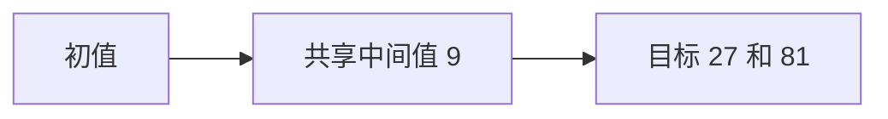

# Santa 2026 · 独立算法演进

目标值只需在 48 个寄存器中的任意一个出现一次。逐题最小化实际指令数，1,000 题求和。
每版从官方题目重新生成候选，前代算法只在当前运行内提供候选。独立验证器以精确整数回放。

| 版本 | 全量指令数 | 较前版减少 | 本次耗时 | 独立验证 |
| --- | ---: | ---: | ---: | --- |
| V1 | 250,642 | — | 156.5 秒 | [1,000 / 1,000](../experiments/reports/v1.json) |

耗时取自本次同步复跑，多个版本并行运行。分数为本地指令计数。各版报告同时记录交接 CSV 与本次输出的 SHA-256。

## V1 · 共享值池与多进制构造

逐个独立构造目标会重复计算同一个中间值。每题从初值建小值池，比较多种进制和目标顺序。对候选表达式按新增依赖数择优，再把共享值图编译成寄存器程序。

初值为 3 时，目标 27 和 81 可共用 9：先算 3×3，再算 9×3 和 9×9。



本次复跑 250,642 步。本次输出与交接 CSV 逐字节一致。候选进制和搜索深度有限，贪心选择可能错过整题更短的路径。交接包日志显示 873 题由自适应候选胜出。

```bash
python graph_solver.py data/puzzles.csv --version v1 --output submissions/v1-score-250642.csv --jobs 4
python verify.py data/puzzles.csv submissions/v1-score-250642.csv
```
