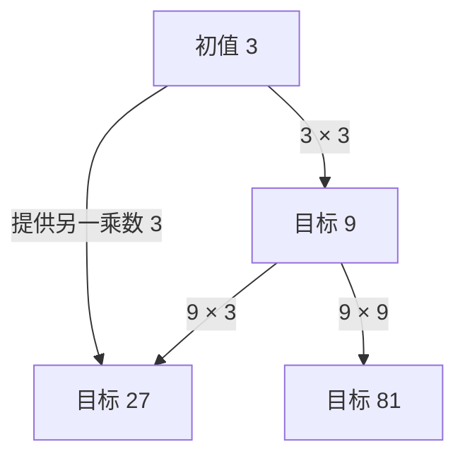
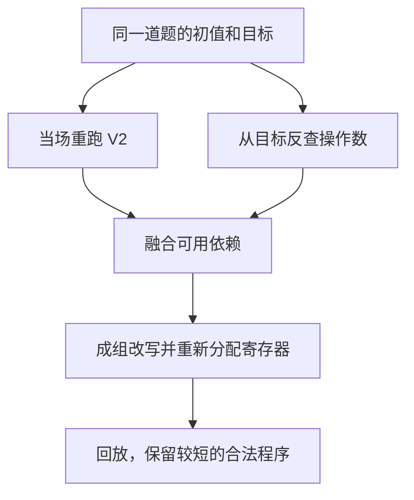
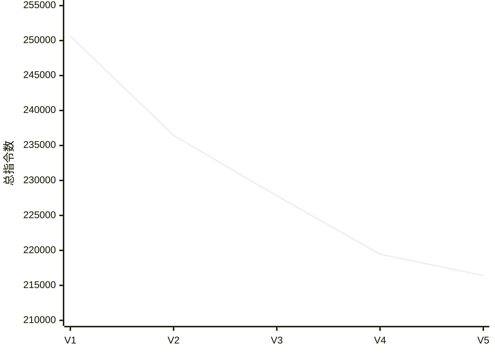

# Santa 2026 · 从手算三步到独立求解 V5

## 1. 这道题让我们做什么？

想象桌上有 48 个格子，叫寄存器。题目先把几个正整数放进去，再给你一张目标清单。每一步从两个已经有值的格子取数，做一次加、减、乘或整除，把结果写进一个格子。可以写回刚才读过的格子。结果必须是正整数，且不能超过该题的数值上限。

你只需让每个目标值**至少出现一次**。初值命中也算，某个目标命中后，装过它的格子可以继续用。提交 CSV 每题一行，`program` 列是该题的 JSON 指令列表。一条指令写成 `[运算符, 左操作数寄存器编号, 右操作数寄存器编号, 写入寄存器编号]`，编号从 0 开始。每题最多 4,096 条指令，程序单元格最多 128 KiB。

全量分数是 1,000 道计分题的实际指令数之和，越低越好。仓库的验证器会从初值逐条回放，检查题号、寄存器、算术规则和目标覆盖，再统计步数。[Kaggle 题面](https://www.kaggle.com/competitions/santa-2026/overview) · [验证器](../src/verify.py)

## 2. 我们先手算一道三步题

假设初值只有 **3**，目标是 **9、27、81**，数值上限为 **100**。我们先用 `3 × 3` 得到 9。接下来，27 可以用 `9 × 3`，81 可以用 `9 × 9`。所以第 2 步要给 9 留个位置。

| 步 | JSON 指令 | 为什么这样写 | 执行后 `R0` | 执行后 `R1` | 本步命中 |
| ---: | --- | --- | ---: | ---: | ---: |
| 0 | — | 初始状态 | 3 | 空 | — |
| 1 | `["*",0,0,1]` | 把 `3 × 3` 写到 `R1` | 3 | 9 | **9** |
| 2 | `["*",1,0,0]` | 把 `9 × 3` 写回 `R0`，保留 `R1` 的 9 | 27 | 9 | **27** |
| 3 | `["*",1,1,1]` | 把 `9 × 9` 写回 `R1` | 27 | 81 | **81** |

**图 1　同一个 9 为两个后续目标服务**



三个目标都不在初值里，每步只产生一个新值，所以至少需要三步。这份程序正好达到下界。你可以把这组数填进[离线模拟器](../src/simulator.html)，先算一遍，再逐步看寄存器如何变化。

## 3. 数字变大以后，基础算法长什么样？

**如果要同时造出 347 和 349，你会从哪一步开始？** 假设寄存器已经有 3、4、7、9、10。把两个目标按十进制拆开，它们都要用到 340。先算出 340，再分别加 7 和 9。

| 分解 | 实际指令序列 | 步数 |
| --- | --- | ---: |
| 每个目标单独构造，重复计算公共部分 | 对 347 算 `30 → 34 → 340 → 347`，对 349 再算 `30 → 34 → 340 → 349` | 8 |
| 把 340 作为共享中间值 | `3×10=30`，`30+4=34`，`34×10=340`，`340+7=347`，`340+9=349` | **5** |

程序把这种分解写成「目标 = 基数 × 商 ± 余数」，对较大的商继续拆。基数也可以用 16、256 或其他容易从初值造出来的数。如果 `348 + 1` 里的 348 比 `340 + 9` 里的 340 更容易复用，前一种分解就值得试。生成候选时先比较需要新增多少个**不同的**中间值，再把依赖图编译成实际指令，分配并复用寄存器，最后以通过回放的实际步数择优。[共享的进制构造与回放](../src/algorithms/common.py)

## 4. 每一代具体多做了什么？

下面的算式是为解释策略设计的。已知值指当前候选池里已有构造方式的值，其中一部分可能还没有写入寄存器。评价候选时要把这些值尚需的构造步数也算进去。

### V1 · 同一道题，换几个基数试试

如果基数 10 不好造，硬用十进制可能第一步就吃亏。V1 一边尝试多组固定基数和目标顺序，一边从题目初值做少量加减乘除，建立一批构造成本较低的值，再从中挑基数。处理一个目标时，它优先选择能复用前面目标依赖的分解。最后只生成目标所需的节点，不把整池候选都算一遍。

V1 的全量基线是 **250,642 步**。这套做法的局限是，当前目标选出的分解会影响后面的题内复用，较好的共享节点可能排到后面才被发现。[V1 源码](../src/algorithms/v1.py) · [V1 复跑报告](reports/v1.json)

### V2 · 先多试一条路，再回头改已选的依赖

如果把目标倒过来做，后面的目标会不会先造出你想要的值？V2 新增一条按原目标列表逆序、搜索更宽的候选路线。选出较短程序后，再回头检查它的依赖图。

假设这份程序用 `16 + 1` 得到 17，其中 16 要额外用 `8 + 8` 构造。若 10 和 7 已经为其他目标生成，就可以改成 `10 + 7`。当 16 没有其他用途时，重排程序就能省掉造 16 的那一步。代码只允许从发现顺序更早的节点引入依赖，以免 17 间接依赖自己，并用六轮局部替换压缩图。

全量记录里，宽搜索先把 **250,642** 降到 **239,693**，图压缩再降到 **236,449**。合计有 **829 题**缩短。[V2 源码](../src/algorithms/v2.py) · [V2 复跑报告](reports/v2.json)

### V3 · 目标已知时，先反推缺哪个数

要得到 91，手上看到 13，你会自然地问「那我有没有 7？」V3 就这样查。对给定目标和一个候选操作数，它反推另一个操作数，用哈希表查它是否已有构造方法。比如乘法先检查 `91 ÷ 13` 能否整除，再查 7；加法可以查 `91 − 13 = 78`。

V3 会把本轮重新生成的 V2 程序和这条新路线提供的依赖图放在一起。它尝试同时更换几个节点的来源，让某个共享节点有机会服务多个目标。搜索使用 100 轮大邻域搜索，候选图仍需重新分配寄存器，再回放确认实际步数。

**图 2　两条独立构造路线如何合并**



全量选择较短的反查候选后为 **228,527 步**，融合后为 **227,799 步**。另有一组固定其余配置的 24 题小样本，单独开启反查后从 **6,941** 降到 **6,537** 步，22 题改善、2 题变长。全量流程会逐题择优。[V3 源码](../src/algorithms/v3.py) · [24 题对照](reports/v3-handoff-ablation.json) · [V3 复跑报告](reports/v3.json)

### V4 · 商离目标近，和商已经在手上，哪个更省？

固定基数 10 来造 103，通常会先试 `10 × 10 + 3`，或 `10 × 11 − 7`。如果我们已有 9 和 13，`10 × 9 + 13` 也只需一次乘法和一次加法，而且可以少造几个操作数。

V4 在传统的向下、向上取整方案外，也去已知值的排序表里查邻近的商。它比较两个乘数和余数一起需要多少新增依赖，已有的乘积也可以直接复用。最后，新路线再和当场重跑的 V3 程序做图融合。

全量降到 **219,462 步**，比 V3 少 **8,337 步**，有 **723 题**缩短。邻近搜索有固定宽度，较远但便宜的商依然可能漏掉。[V4 源码](../src/algorithms/v4.py) · [V4 复跑报告](reports/v4.json)

### V5 · 如果便宜的余数更大呢？

把基数换成 **64**，目标取 **1,003**。常规余数是 43，但 171 和 43 除以 64 都余 43。若 171 已经由 `9 × 19` 廉价构造，商 13 也容易取得，就可以走 `64 × 13 + 171 = 1,003`，少造成本较高的余数 43。

| 目标 1,003，基数 64 | 商 | 余数或偏移 | 算式 |
| --- | ---: | ---: | --- |
| 向下取整 | 15 | 43 | `64 × 15 + 43` |
| 向上取整 | 16 | 21 | `64 × 16 − 21` |
| 第 43 号余数桶里的候选 | 13 | 171 | `64 × 13 + 171` |

V5 先用廉价因子配出一个乘积池。这个池有两个用法。第一，拿一个乘积去查补数，找到两个已知值的和或差；第二，对选中的基数按「除以基数所得的余数」给便宜乘积分桶，每桶最多保留两个。这样除了查 43 本身，还可以直接查到与 43 同余的便宜候选。

全量中，加入 V5 构造候选后为 **217,279 步**，与当场生成的 V4 候选融合后为 **216,404 步**。8 题构造器对照里，单独扩大值池从 **1,855** 走到 **1,863** 步，加入双乘积匹配仍为 **1,863**，再加入模余数搜索才降到 **1,850**。候选更多时，有限搜索有时会挤掉原来的好分解，因此最终仍以合法程序的实测步数择优。[V5 源码](../src/algorithms/v5.py) · [8 题对照](reports/v5-handoff-ablation.json) · [V5 复跑报告](reports/v5.json)

## 5. 把五代放在同一道题和全量数据上看

取正式题 `scored_0626`，让五个版本分别从同一份题目重新生成程序，得到 **275 → 273 → 258 → 256 → 249 步**。另一个例子 `scored_0289` 是 **28 → 28 → 27 → 27 → 27 步**。两题的五版程序都通过了验证。每一代并不会让每一道题都少一步，只要找到更短的合法程序，就用它替换该题的旧候选。

**图 3　同一批 1,000 道题的全量指令数**



| 版本 | 全量指令数 | 比上一代少 | 变短 / 持平 / 变长题数 | 本次复跑耗时 | 独立验证 |
| --- | ---: | ---: | ---: | ---: | --- |
| V1 | 250,642 | — | — | 156.5 秒 | [1,000 / 1,000](reports/v1.json) |
| V2 | 236,449 | 14,193 | 829 / 171 / 0 | 285.5 秒 | [1,000 / 1,000](reports/v2.json) |
| V3 | 227,799 | 8,650 | 734 / 266 / 0 | 424.8 秒 | [1,000 / 1,000](reports/v3.json) |
| V4 | 219,462 | 8,337 | 723 / 277 / 0 | 624.2 秒 | [1,000 / 1,000](reports/v4.json) |
| V5 | **216,404** | 3,058 | 416 / 584 / 0 | 640.6 秒 | [1,000 / 1,000](reports/v5.json) |

从 V1 到 V5 共少 **34,238 步（13.66%）**。表中是本地验证的指令总数。耗时来自多版本并行的那次复跑，且 V5 用了 6 个工作进程，其他版本用 4 个。报告记录了输入和输出的 SHA-256，五个版本的复跑输出均与对应交接 CSV 逐字节一致。

## 6. 想自己跑一遍？

将从 Kaggle 下载的 `puzzles.csv` 放到赛题目录下的 `data/`。在 `competitions/santa-2026` 内运行以下命令。把 `version` 改为 `v1` 到 `v5` 中的任一个，即可重跑相应版本。

```bash
version=v5
python src/graph_solver.py data/puzzles.csv --version "$version" --output "submissions/${version}-rerun.csv" --jobs 4
python src/verify.py data/puzzles.csv "submissions/${version}-rerun.csv"
```

每个版本只读题目 CSV；后代重跑前代算法，是为了在这次运行里生成候选。生成的提交可与官方题目一起导入[离线模拟器](../src/simulator.html)，选同一个题号看各版的步数和寄存器回放。[仓库运行说明](../README.md)
