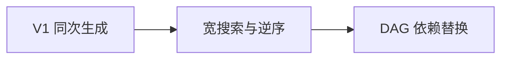

# Santa 2026 · 独立算法演进

目标值只需在 48 个寄存器中的任意一个出现一次。逐题最小化实际指令数，1,000 题求和。
每版从官方题目重新生成候选，前代算法只在当前运行内提供候选。独立验证器以精确整数回放。

| 版本 | 全量指令数 | 较前版减少 | 本次耗时 | 独立验证 |
| --- | ---: | ---: | ---: | --- |
| V1 | 250,642 | — | 156.5 秒 | [1,000 / 1,000](../experiments/reports/v1.json) |
| V2 | 236,449 | 14,193 | 285.5 秒 | [1,000 / 1,000](../experiments/reports/v2.json) |
| V3 | 227,799 | 8,650 | 424.8 秒 | [1,000 / 1,000](../experiments/reports/v3.json) |
| V4 | 219,462 | 8,337 | 624.2 秒 | [1,000 / 1,000](../experiments/reports/v4.json) |
| V5 | 216,404 | 3,058 | 640.6 秒 | [1,000 / 1,000](../experiments/reports/v5.json) |

耗时取自本次同步复跑，多个版本并行运行。分数为本地指令计数。各版报告同时记录交接 CSV 与本次输出的 SHA-256。

## V1 · 共享值池与多进制构造

逐个独立构造目标会重复计算同一个中间值。每题从初值建小值池，比较多种进制和目标顺序。对候选表达式按新增依赖数择优，再把共享值图编译成寄存器程序。

初值为 3 时，目标 27 和 81 可共用 9：先算 3×3，再算 9×3 和 9×9。


本次复跑 250,642 步。本次输出与交接 CSV 逐字节一致。候选进制和搜索深度有限，贪心选择可能错过整题更短的路径。交接包日志显示 873 题由自适应候选胜出。

```bash
python graph_solver.py data/puzzles.csv --version v1 --output submissions/v1-score-250642.csv --jobs 4
python verify.py data/puzzles.csv submissions/v1-score-250642.csv
```

## V2 · 扩展搜索与 DAG 压缩

单一自适应搜索容易错过由其他目标先构造的操作数。新增逆目标顺序的宽搜索，然后对产生的有向无环图做六轮局部依赖替换。

若图中已有 10、7、1，目标 17 可用 10+7 替换原来需要新建 16 的 16+1。



本次复跑 236,449 步。本次输出与交接 CSV 逐字节一致。较前版 829 题缩短，171 题持平，0 题变长。替换受发现顺序约束。交接包的同次运行中，V1 候选 250,642 步，扩大搜索后 239,693 步，DAG 压缩后 236,449 步。

```bash
python graph_solver.py data/puzzles.csv --version v2 --output submissions/v2-score-236449.csv --jobs 4
python verify.py data/puzzles.csv submissions/v2-score-236449.csv
```

## V3 · 双向补数查询与多图融合

前向组合受候选池宽度限制。从目标反推另一操作数，再用哈希查候选值。融合本轮生成的两份值图，以 100 轮大邻域搜索优化活跃依赖，再按实际发射步数择优。

要构造 91，池中已有 13 时可直接查 91÷13 是否等于池中的 7。


本次复跑 227,799 步。本次输出与交接 CSV 逐字节一致。较前版 734 题缩短，266 题持平，0 题变长。只检索有限候选池。交接包固定其余参数的 24 题消融中，补数查询将 6,941 步降至 6,537 步，22 题改善、2 题变长。全量补数候选择优 228,527 步，融合后 227,799 步。

```bash
python graph_solver.py data/puzzles.csv --version v3 --output submissions/v3-score-227799.csv --jobs 4
python verify.py data/puzzles.csv submissions/v3-score-227799.csv
```

## V4 · 双乘数联合匹配

固定基数后只取向下或向上取整的商，可能错过池中已有的廉价商。扩大低成本前向值池，从已用节点选择基数，并在已知值中找相邻的商。最小化两个乘数和余数的新增依赖，再与本轮重新生成的 V3 程序融合。

若 10、9、13 已知，103 可写成 10×9+13。


本次复跑 219,462 步。本次输出与交接 CSV 逐字节一致。较前版 723 题缩短，277 题持平，0 题变长。只检查有限的邻近因子、递归深度和候选宽度。交接包 24 题对照中，V3 为 6,473 步，候选择优为 6,310 步，融合为 6,290 步。全量 723 题变短。

```bash
python graph_solver.py data/puzzles.csv --version v4 --output submissions/v4-score-219462.csv --jobs 4
python verify.py data/puzzles.csv submissions/v4-score-219462.csv
```

## V5 · 乘积池与模余数索引

只看邻近商可能错过成本较低的非标准余数。缓存廉价乘积，通过补数查找匹配两项。针对有限基数按模建索引，从每个桶取廉价余数，并与本轮生成的 V4 候选做 100 轮图优化。

目标 1003、基数 10 时，余数可取 103，商取 90，因为 103 ≡ 1003 (mod 10)。两者已共享时，10×90+103 可能比使用最小余数更省。


本次复跑 216,404 步。本次输出与交接 CSV 逐字节一致。较前版 416 题缩短，584 题持平，0 题变长。每桶候选和搜索深度有限。交接包全量记录为 V4 候选 219,462 步、V5 候选择优 217,279 步、融合后 216,404 步。仅构造器的 8 题消融为 1,855 → 1,863 → 1,863 → 1,850 步，依次加入扩大值池、双乘积匹配和模余数。

```bash
python graph_solver.py data/puzzles.csv --version v5 --output submissions/v5-score-216404.csv --jobs 6
python verify.py data/puzzles.csv submissions/v5-score-216404.csv
```
