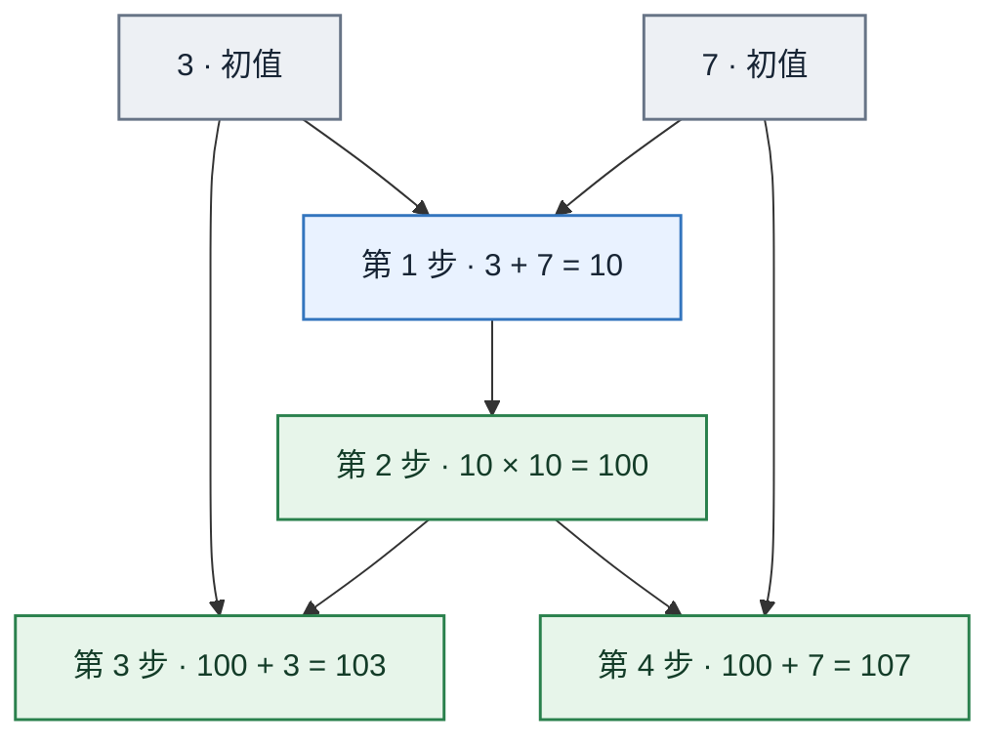
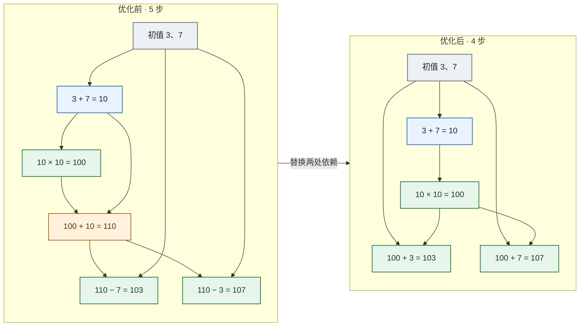
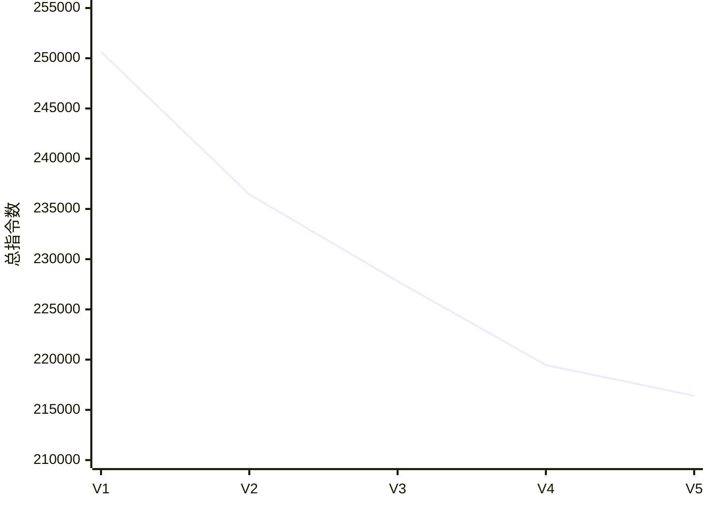
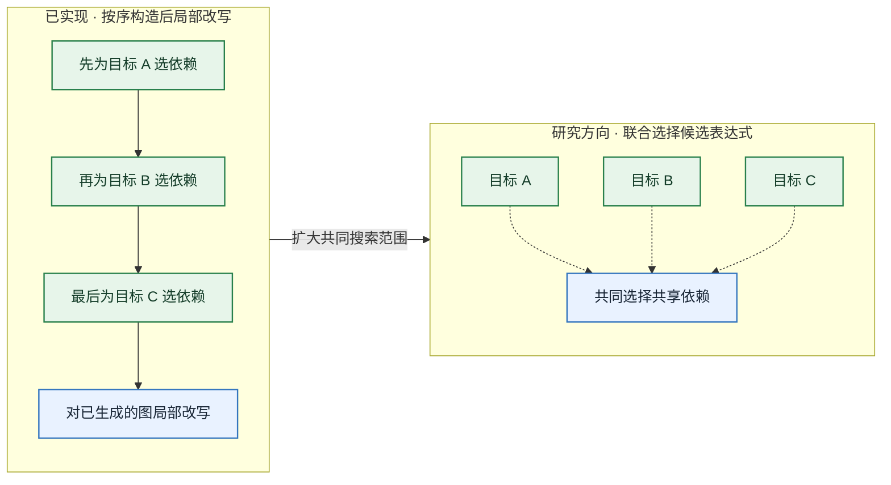
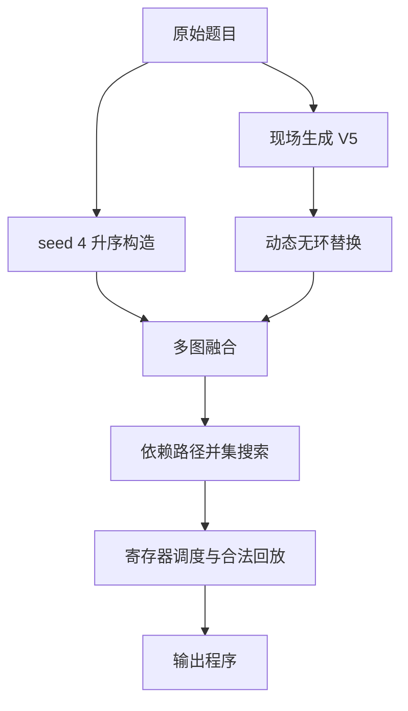
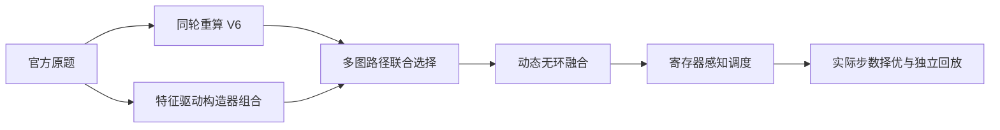
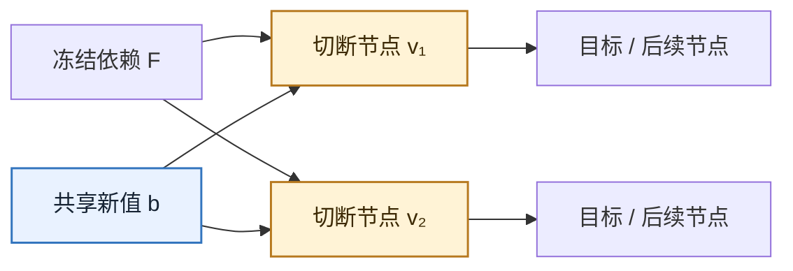

# Santa 2026 · 多目标算术程序的独立构造与压缩

**摘要**　每道题给定一组初值和一组目标值，要求用 48 个寄存器和尽量少的算术指令，让所有目标至少出现一次。求解分两层。先搜索可共享中间值的算术依赖图，再编译成满足寄存器限制的程序，用独立回放比较实际指令数。V1–V5 均从题目重新生成程序。在同一批 1,000 道题上，V1–V5 的总指令数由 **250,642** 降至 **216,404**，减少 **34,238 步（13.66%）**，五代输出均通过独立验证；后续 V6 为 **204,255**，V7 为 **198,388**，V8 Final 为 **194,444**。

## 1. 赛题在问什么？

想象桌上有 48 个格子，叫寄存器。题目先把几个正整数放进去，再给你一张目标清单。每一步从两个有值的格子读数，做一次加、减、乘或整除，把结果写回一个格子。**同一个中间值可以服务多个目标，某个目标一旦出现，就可以覆盖它所在的寄存器。**

提交 CSV 的每一行对应一道题，`program` 列保存 JSON 指令列表。指令格式是 `[运算符, 左操作数寄存器编号, 右操作数寄存器编号, 写入寄存器编号]`，编号从 0 开始。结果必须是正整数且不超过题目上限，单题最多 4,096 条指令，程序单元格最多 128 KiB。1,000 道计分题的实际指令数相加就是本地分数。[Kaggle 题面](https://www.kaggle.com/competitions/santa-2026/overview) · [独立验证器](../src/verify.py)

## 2. 跟着我们先手算两道题

### 2.1 用 3 得到 9、27、81

初始只有 `R0 = 3`，数值上限为 100。先算出 9，再决定哪个寄存器要留下来。

| 步 | 运算和写入 | JSON 指令 | 执行后 `R0` | 执行后 `R1` |
| ---: | --- | --- | ---: | ---: |
| 0 | 初始状态 | — | 3 | 空 |
| 1 | 3 × 3 = 9，写入 `R1` | `["*",0,0,1]` | 3 | **9** |
| 2 | 9 × 3 = 27，写回 `R0` | `["*",1,0,0]` | **27** | 9 |
| 3 | 9 × 9 = 81，写回 `R1` | `["*",1,1,1]` | 27 | **81** |

三个新目标至少需要三条指令，因此这份程序是最优的。第 3 步覆盖了 9，它仍是已完成的目标。可以把这组数填进[离线模拟器](../src/simulator.html)逐步回放。

### 2.2 用 3 和 7 得到 100、103、107

如果分别构造三个目标，同一个 100 可能被算三次。我们先用 3 和 7 得到 10，再平方得到 100。此时 100 自己已经命中一个目标，同时还可以继续为 103 和 107 提供原料。

**图 1　共享值池如何覆盖三个目标**



灰色表示初值，蓝色表示共享中间值，绿色表示目标。箭头从操作数指向结果。100 同时是目标和共享操作数，图中按目标着色。平方读取同一个值两次，因此图上只画一条依赖箭头。

| 步 | 算式 | 写入 | 这一步的作用 |
| ---: | --- | --- | --- |
| 1 | 3 + 7 = 10 | `R2` | 构造公共基数 |
| 2 | 10 × 10 = 100 | `R2` | 达成 100，并保留它供后续使用 |
| 3 | 100 + 3 = 103 | `R0` | 达成 103 |
| 4 | 100 + 7 = 107 | `R1` | 达成 107 |

目标 100、103、107 都不在初值里，也没有一个能由 3 和 7 一步算出。第一步只能准备中间值，其余三步至少各命中一个目标，所以**四步已经最优**。这里取数值上限 120。逐目标重算同样的分解需要 $`2+3+3=8`$ 步，共享后是 4 步。这个 8 步只是比较用的独立构造基线。

## 3. 从寄存器执行到值依赖图

### 3.1 真实目标函数是什么？

设一道题为 $`\mathcal I=(\mathbf s,T,L,R)`$ 。 $`\mathbf s`$ 是按寄存器顺序给出的初值列表， $`S`$ 是初值的集合， $`T`$ 是目标集合， $`L`$ 是数值上限， $`R=48`$ 。第 $`k`$ 步执行前的寄存器内容记为 $`\mathbf r^{(k-1)}`$ ，已命中目标记为 $`H_{k-1}`$ 。对指令 $`p_k=(o,i,j,d)`$ ，按下面的状态转移先计算 $`z_k`$ ，再覆写寄存器 $`d`$ 。

```math
\begin{aligned}
z_k &= o\!\left(r_i^{(k-1)},r_j^{(k-1)}\right), \qquad 1\le z_k\le L,\\
r_d^{(k)} &= z_k,\qquad r_h^{(k)}=r_h^{(k-1)}\quad(h\ne d),\\
H_0 &= T\cap S,\qquad H_k=H_{k-1}\cup(T\cap\{z_k\}).
\end{aligned}
```

$`i,j,d`$ 必须是合法寄存器编号，输入位置必须已初始化。对除法，除数必须整除被除数。设 $`\mathcal F(\mathcal I)`$ 是满足算术、寄存器、程序长度及编码大小限制且最后有 $`H_K=T`$ 的程序集合。单题及全量要最小化的量分别是

```math
K_R^\star(\mathcal I)=\min_{\pi\in\mathcal F(\mathcal I)}|\pi|,
\qquad
Q=\sum_{i=1}^{1000}|\pi_i|.
```

每步最多命中一个此前没见过的目标，所以 $`K_R^\star\ge |T\setminus S|`$ 。如果 $`T\setminus S`$ 非空且没有任何初值一阶运算能命中它，下界可以加强为 $`K_R^\star\ge |T\setminus S|+1`$ ，这就是上面四步题的证明。

### 3.2 我们为什么先优化图？

给每个非初值 $`v`$ 选一个构造式 $`v=o(a,b)`$ ，画两条从操作数到结果的依赖边（两操作数相同时可以合画一条）。用 $`D_G(t)`$ 表示生成目标 $`t`$ 所需的**非初值**集合，包括 $`t`$ 自身（若 $`t`$ 为初值，则集合为空）。对固定的无环构造，依赖递推和整题的有效节点成本是

```math
D_G(v)=
\begin{cases}
\varnothing,&v\in S,\\
D_G(a)\cup D_G(b)\cup\{v\},&v=o(a,b),\ v\notin S,
\end{cases}
\qquad
C(G)=\left|\bigcup_{t\in T} D_G(t)\right|.
```

如果每个目标单独算，成本是各自依赖数之和。共享节省的是重复节点。令 $`m(v)`$ 表示有多少个目标的依赖集合包含 $`v`$ ，则

```math
\sum_{t\in T}|D_G(t)|-C(G)
=\sum_{v:\,m(v)>0}\bigl(m(v)-1\bigr).
```

等式左侧把同一个 $`v`$ 数了 $`m(v)`$ 次，再为全局构造扣掉一次。图 1 中 10 和 100 都为三个目标所用，各省两次构造。处理新目标时，若先前选中的依赖并集为 $`U`$ ，则这条候选路线的图上边际成本为

```math
|U\cup D_G(t)|-|U|=|D_G(t)\setminus U|.
```

这就是 V1 偏好共享的原因。同一条算式看起来很长，但如果它的大部分依赖已经选过，新增成本可能很小。

### 3.3 图上一个节点，何时等于一条指令？

若空间无限，可以按照拓扑顺序把目标依赖闭包里的各个非初值算一次，并一直保留所有结果，所需步数就是 $`C(G)`$ 。反过来，取任意合法程序中各个值**首次**出现时使用的运算。它的操作数一定更早出现，因此得到无环图。剪去与目标无关的节点后，剩余非初值数至多等于原程序步数。于是得到以下松弛下界。

```math
\min_{G\ \text{合法值图}} C(G)\ \le\ K_R^\star(\mathcal I).
```

公式左侧忽略了固定寄存器数以及程序长度和编码上限。对同一个图，若有限寄存器让一些稍后还要用的值被提前覆盖，就可能需要重算，甚至找不到可行调度。求解器会根据后续使用释放寄存器，必要时再生成被覆盖的值，最后按**回放后的指令数**比较候选。这也解释了为什么图更小，仍可能编译不出更短的程序。[共享构造与寄存器分配](../src/algorithms/common.py)

## 4. 每一代在优化哪一层？

下面用小算式解释候选是怎么来的。实际搜索会先限定候选池、递归深度和候选宽度。池里的数已有构造方式，其中一些还没有写入寄存器，比较时仍须计入它们未被共享的依赖。

### V1 · 换个好造的基数，能少算多少？

把目标 $`t`$ 按基数 $`b>1`$ 做欧几里得除法，可写成下面两种分解。

```math
q=\left\lfloor\frac{t}{b}\right\rfloor,\qquad r=t-bq,\qquad
t=bq+r=b(q+1)-(b-r),\quad 0\le r<b.
```

第一种分解从下方靠近目标，第二种从上方靠近。如果 $`b(q+1)>L`$ ，上方的乘积会越界，这条路线必须排除。如果所需的商也很大，继续递归分解它。比如同时构造 347 和 349，假设 3、4、7、9、10 已经在手上，分别算要走两次 $`30\to34\to340`$ 。共享 340 后，只要三步构造公共部分，加上两次末位加法，共 **5 步**。

实现中先尝试多组固定基数和目标顺序，再用初值做少量四则运算，建立低成本候选池，自适应选择基数。候选可按第 3 节的边际成本排序，再用实际回放择优。全量基线为 **250,642 步**。[V1 源码](../src/algorithms/v1.py) · [复跑报告](reports/v1.json)

### V2 · 目标已经算出来了，还能缩短依赖图吗？

V2 增加逆序构造和更宽的候选搜索。程序生成后，它再枚举由**更早出现的值**组成的等价算式，然后改写活跃节点的依赖，保持图无环。令 $`\rho_G(v)>0`$ 表示 $`v`$ 仍被至少一个目标的依赖闭包用到。一次改写的成本变化是

```math
\Delta C=\sum_{v\notin S}
\left(\mathbf 1[\rho_{G'}(v)>0]-\mathbf 1[\rho_G(v)>0]\right).
```

一个中间值只有在**最后一处引用**移除后才真正省下一步。回到图 1 的同一道题，假设旧程序已经算出 100，但随后又先造 110，再用它得到 103 和 107。仅改写其中一个目标，另一个还会需要 110。两个目标都改写以后，110 才能剪掉。

**图 2　同一组目标的依赖改写**



橙色标出改写后失去所有引用的 110。两侧都能用同一组初值合法回放，步数从 5 降到 4。V2 在六轮局部扫描中按有效依赖数比较替换，并尝试不同的求值顺序。全量记录中，宽搜索先把 **250,642** 降到 **239,693**，图压缩再降到 **236,449**。[V2 源码](../src/algorithms/v2.py) · [复跑报告](reports/v2.json)

### V3 · 已知目标和一个操作数，另一个能直接查出来吗？

比如要得到 91，已有 13，你可以先算 $`91/13=7`$ ，再查候选池里是否有 7。设 $`t`$ 是目标， $`a`$ 是手里已有构造方式的值，可以反推以下六种候选。

| 希望成立的算式 | 反推出的另一个操作数 $`b`$ | 额外条件 |
| --- | --- | --- |
| $`t=a+b`$ | $`b=t-a`$ | $`t>a`$ |
| $`t=a-b`$ | $`b=a-t`$ | $`a>t`$ |
| $`t=b-a`$ | $`b=t+a`$ | $`b\le L`$ |
| $`t=ab`$ | $`b=t/a`$ | $`a\mid t`$ |
| $`t=a/b`$ | $`b=a/t`$ | $`t\mid a`$ |
| $`t=b/a`$ | $`b=ta`$ | $`b\le L`$ |

每条候选都要检查 $`1\le b\le L`$ 并在哈希表中查值。对固定目标和 $`M`$ 个待探查的 $`a`$ ，反推阶段只提出至多 $`6M`$ 个查询。这只是反查子过程的数量上界，整题仍要构造、融合和编译。V3 把这条新路线和本轮生成的 V2 依赖图融合，并在最多 100 轮大邻域搜索中成组改写依赖。有限候选池决定了它能找到哪些表达式。

全量反查候选择优后为 **228,527 步**，图融合后为 **227,799 步**。保持其余配置固定的 24 题小样本里，单独开启反查由 **6,941** 降到 **6,537 步**，22 题改善、2 题变长。[V3 源码](../src/algorithms/v3.py) · [24 题对照](reports/v3-handoff-ablation.json) · [复跑报告](reports/v3.json)

### V4 · 哪个商更好，应该看数值距离还是构造成本？

固定基数 10 去造 103，通常先试 $`10\times10+3`$ 或 $`10\times11-7`$ 。如果 9 和 13 已经有了， $`10\times9+13`$ 也只需要一乘一加。V4 对已有值排序，查找标准商附近已经容易构造的值 $`\tilde{q}`$ ，然后重新计算乘积和偏移量。

```math
p=b\tilde{q},\qquad \tilde{r}=|t-p|,\qquad t=p+\mathrm{sgn}(t-p)\,\tilde{r}.
```

当 $`p`$ 尚需构造且 $`\tilde{r}>0`$ 时，该方案的图上边际开销是

```math
\left|\left(D_G(b)\cup D_G(\tilde{q})\cup D_G(\tilde{r})\cup\{p,t\}\right)\setminus U\right|.
```

已有 $`p`$ 时可复用 $`D_G(p)`$ 。 $`\tilde{r}=0`$ 时乘积本身便是目标，少一次加减。这个成本衡量的是新增节点数，意味着一个数值更远的商仍可能更便宜。V4 的邻近搜索只看有限候选，再与本轮重新生成的 V3 程序融合。历史的 24 题对照记录为 **6,473 → 6,310 → 6,290** 步，依次对应 V3、加入 V4 候选后逐题择优、再做图融合。全量为 **219,462 步**，**723 题**缩短。[V4 源码](../src/algorithms/v4.py) · [24 题历史记录](https://github.com/Leonardo-F/kaggle-lab/blob/35a688db3a01182d07d1ae2000a75f3191e1b57e/competitions/santa-2026/docs/algorithm-evolution.md) · [复跑报告](reports/v4.json)

### V5 · 便宜的余数藏在哪个桶里？

V5 从便宜因子出发构造乘积池。一条路线对乘积 $`p`$ 查询 $`t-p`$ 、 $`p-t`$ 或 $`p+t`$ ，尝试由已知乘积和另一个已知值一步合成目标。另一条路线给选中的基数 $`b`$ 建模索引。对符号 $`\sigma\in\{-1,+1\}`$ ，从 $`t=bq+\sigma r`$ 可直接推出

```math
r\equiv \sigma t\pmod b,\qquad q=\frac{t-\sigma r}{b}.
```

因此先查第 $`\sigma t\bmod b`$ 个桶，取有便宜构造的 $`r`$ ，再算出对应的 $`q`$ 。只要商为正整数、乘积在上限内，就可以尝试大于 $`b`$ 的余数候选。实现为每个所选基数的每个桶最多保留两个廉价乘积。

| 目标 1,003，基数 64 | 商 | 余数或偏移 | 算式 |
| --- | ---: | ---: | --- |
| 向下取整 | 15 | 43 | $`64\times15+43`$ |
| 向上取整 | 16 | 21 | $`64\times16-21`$ |
| 查第 43 号余数桶 | 13 | 171 | $`64\times13+171`$ |

171 和 43 同余。如果 171 已经可以用 $`9\times19`$ 廉价取得，同时 13 也已构造，就有机会省去造 43 的成本。实测全量构造候选择优后为 **217,279 步**，融合后为 **216,404 步**。8 题构造器消融依次为 **1,855 → 1,863 → 1,863 → 1,850** 步，对应基线、扩大值池、再加双乘积匹配、再加模余数搜索。扩大候选池在有限搜索预算下并不保证结果改善。[V5 源码](../src/algorithms/v5.py) · [8 题对照](reports/v5-handoff-ablation.json) · [复跑报告](reports/v5.json)

## 5. 实验结果

### 5.1 实验从哪条路线开始？

最初的讨论从多进制切换、算术链重写入手，后续实验还会以已有程序为输入做压缩。历史记录里的 **285,288 → 272,748** 和 **269,369 → 263,575** 对应该阶段的不同实验。下表只比较独立构造的 V1–V5。各版本接收同一份原始题目 CSV，前代候选也在本次调用中生成。公开答案合并结果仅见历史对比分析，未用作 V1–V5 的求解输入。[早期实验](progress.md) · [公开方案对比](frontier-analysis.md)

### 5.2 同一题和全量分别怎么比较？

取正式题 `scored_0626`，让五个版本分别从同一份题目重新生成程序，得到 **275 → 273 → 258 → 256 → 249 步**。另一个例子 `scored_0289` 是 **28 → 28 → 27 → 27 → 27 步**。两题的五版程序都通过了验证。每一代并不会让每一道题都少一步，只要找到更短的合法程序，就用它替换该题的旧候选。

**图 3　同一批 1,000 道题的全量指令数**



| 版本 | 全量指令数 | 比上一代少 | 变短 / 持平 / 变长题数 | 本次复跑耗时 | 独立验证 |
| --- | ---: | ---: | ---: | ---: | --- |
| V1 | 250,642 | — | — | 156.5 秒 | [1,000 / 1,000](reports/v1.json) |
| V2 | 236,449 | 14,193 | 829 / 171 / 0 | 285.5 秒 | [1,000 / 1,000](reports/v2.json) |
| V3 | 227,799 | 8,650 | 734 / 266 / 0 | 424.8 秒 | [1,000 / 1,000](reports/v3.json) |
| V4 | 219,462 | 8,337 | 723 / 277 / 0 | 624.2 秒 | [1,000 / 1,000](reports/v4.json) |
| V5 | **216,404** | 3,058 | 416 / 584 / 0 | 640.6 秒 | [1,000 / 1,000](reports/v5.json) |

从 V1 到 V5 共少 **34,238 步（13.66%）**。表中是本地验证的指令总数。耗时来自多版本并行的那次复跑，且 V5 用了 6 个工作进程，其他版本用 4 个。报告记录了输入和输出的 SHA-256，五个版本的复跑输出均与对应交接 CSV 逐字节一致。

## 6. 局限与研究方向

### 6.1 从沿目标顺序构造，走向联合选择表达式

假如你先处理 A，它会挑一条眼下最省的路。等到 B、C 出现时，A 早先换一条路，也许会让三者共用更多值。V1 的构造顺序会产生这种路径依赖。V2–V5 已经可以在生成的依赖图上进行局部联合改写，仍受候选图、出现顺序和搜索预算限制。下一步可以先为每个值保留多条构造式，再联合决定哪些值值得进入整题的共享图。

**图 4　按序构造与全局联合选择**



实线表示构造和改写的顺序，虚线表示三个目标共同作用于选值决策。图右是研究模型，下面的整数规划未用于表中的 V1–V5 成绩。

### 6.2 怎样把右图写成可求解的模型？

给定有限候选值集合 $`V`$ ，包含 $`S`$ 和 $`T`$ 。令 $`E_v`$ 收录产出 $`v`$ 的合法候选式。每个候选式 $`e`$ 有两个输入 $`a_e,b_e\in V`$ 。用二元变量 $`x_v`$ 表示是否保留值 $`v`$ ， $`y_e`$ 表示是否采用表达式 $`e`$ 。再为各值设置整数拓扑层次 $`h_v\in\{0,\ldots,|V|-1\}`$ ，取 $`M=|V|`$ 。模型为

```math
\begin{aligned}
\min\quad & \sum_{v\in V\setminus S} x_v\\
\text{s.t.}\quad
& x_v=1 && (v\in S\cup T),\\
& \sum_{e\in E_v}y_e=x_v && (v\in V\setminus S),\\
& x_{a_e}\ge y_e,\qquad x_{b_e}\ge y_e && (v\in V\setminus S,\ e\in E_v),\\
& h_v\ge h_{a_e}+1-M(1-y_e) && (v\in V\setminus S,\ e\in E_v),\\
& h_v\ge h_{b_e}+1-M(1-y_e) && (v\in V\setminus S,\ e\in E_v),\\
& h_s=0 && (s\in S).
\end{aligned}
```

前三行保证目标被选择、每个选中的非初值恰有一个来源、两项操作数也被选择。若 $`y_e=1`$ ，两条层次约束迫使输出排在输入之后，因而选中的表达式不能成环。若 $`y_e=0`$ ， $`M`$ 使这两个约束自动满足。反过来，任何候选池内的合法构造 DAG 都能按拓扑次序赋予 $`h_v`$ ，并映射为这个模型的可行解。因此在**给定候选池及无限寄存器松弛**下，模型优化的正是非初值节点数。要得到赛题上的可行成绩，还需要将结果调度到 48 个寄存器并实际回放。

### 6.3 报告里还需要补哪些证据？

- **小题最优性。** 用完整状态 $`(\mathbf r,H)`$ 在小上限实例上做广度优先搜索。每条合法指令是代价为 1 的边，首次达到 $`H=T`$ 的深度就是最少步数。可以据此报告启发式程序离最优值差多少。
- **同预算消融。** 固定题集、硬件、工作进程、随机种子和搜索预算，分开开关补数查找、图融合、邻近商和模余数。记录总步数、变短／持平／变长题数和耗时分布。现有 24 题和 8 题对照可用来展示机制，单模块在全量集的贡献仍需按相同预算测量。
- **图成本与调度成本。** 对同一个候选记录 $`C(G)`$ 和实际步数 $`|\pi|`$ ，统计重算次数与峰值活跃值数，定位主要瓶颈来自构造还是寄存器调度。保留 48 寄存器下的独立回放结果，便于复核。

## 7. 复现

将从 Kaggle 下载的 `puzzles.csv` 放到赛题目录下的 `data/`。在 `competitions/santa-2026` 内运行以下命令。把 `version` 改为 `v1` 到 `v5` 中的任一个，即可重跑相应版本。

```bash
version=v5
python src/graph_solver.py data/puzzles.csv --version "$version" --output "submissions/${version}-rerun.csv" --jobs 4
python src/verify.py data/puzzles.csv "submissions/${version}-rerun.csv"
```

每个版本只读题目 CSV。后代会在同一次运行里重跑前代算法，生成供比较的候选。生成的提交可与官方题目一起导入[离线模拟器](../src/simulator.html)，选同一个题号看各版的步数和寄存器回放。[仓库运行说明](../README.md)

## 8. 相关工作

- 加法序列研究同一组运算如何覆盖多个量。Santa 在初值为 1、只允许加法、数值上限充足且寄存器无限时，可以视作寻找包含所有目标的加法序列。完整赛题还允许减法、乘法和整除，并限制寄存器。 [Bos 与 Coster，*Addition Chain Heuristics*，CRYPTO ’89](https://link.springer.com/chapter/10.1007/0-387-34805-0_37)
- 有限寄存器上的算术表达式求值为调度阶段提供了参考。Santa 还要从许多等价表达式中选择跨目标的依赖图。 [Sethi 与 Ullman，*The Generation of Optimal Code for Arithmetic Expressions*，JACM 1970](https://doi.org/10.1145/321607.321620)

## V6：动态无环替换与完整路径联合选择

V5 搜索受已有节点发现顺序限制；V6 为已出现的数值枚举其他合法表达式，每次替换前沿当前依赖图检查是否形成环，引用计数维护被目标激活的节点。以本轮现场生成的 V5 程序及 seed=4 的升序构造结果构成候选，允许融合；不会读入历史答案。

对目标 $t$ 及其候选路径 $p$，记依赖节点集合为 $D_{t,p}$。使用整数 bitset 表示集合，联合搜索的代理目标是

$$\min_{p_t} \left|\bigcup_{t\in T} D_{t,p_t}\right|.$$

候选空间有限，该目标也不含寄存器重算开销，并非指令数的精确全局最优。算法通过坐标搜索和 300 轮模拟退火选路径，正向重建依赖图、尝试目标调度并按下一次使用位置分配寄存器；仅在完整回放合法且实际指令更少时接受。节点搜索默认 180 轮，`--no-extra` 可关闭额外构造器进行消融。



交接包此前 100 题样本的阶段结果依次为 22,653、22,602、21,492、21,476、21,298 步；样本并非均匀随机，不能当成全量结果。此前全量实验记录的消融阶段为：同轮 V5 216,404、动态无环搜索 215,938、额外候选及融合 205,959、路径联合选择 **204,255**；799 题变短、201 持平、0 变长，路径联合选择额外改善 125 题。这些是交接包记录，不是 Kaggle 榜单成绩；当前仓库版本的复跑结果见 V6 报告。

## V7：自适应多构造器与寄存器联合调度

V6 的搜索仍然从一条固定的升序构造链出发，最后由一张依赖图编译成指令。V7 保留同一次调用内重新生成的 V6 程序作为基线，再按题目特征增加最多三个构造候选，把所有当前轮候选放进同一个路径联合选择，做动态无环融合，最后在真实寄存器限制下重排指令。求解器只读官方题目 CSV，不读历史答案或检查点中的程序。



### 7.1 候选构造器如何按题目特征选择？

记 $`n=|T|`$ 为目标数， $`w_{\max}=\max_{t\in T}\operatorname{bitlen}(t)`$ ， $`w_{\min}=\min_{t\in T}\operatorname{bitlen}(t)`$ ，跨度为 $`w_{\max}-w_{\min}`$ 。V7 先用固定规则从 $`T`$ 的排序和 V5 构造器的随机种子生成候选，规则不依赖答案：

| 条件 | 排序 | 种子 | 位宽 | 目的 |
| --- | --- | ---: | ---: | --- |
| 总是启用 | 数值升序 | 5 | 3 | 稳定的基线候选 |
| $`n\ge20`$ 且跨度 $`\ge6`$ | 位宽降序、同宽按数值 | 6 | 3 | 让相近位宽的目标共享商和余数骨架 |
| $`n\ge20`$ 且跨度 $`<6`$ | 按 $`t\bmod256`$ 分组 | 6 | 3 | 让低位相同的目标共享低字节构造 |
| $`n\ge20`$ 且 $`w_{\max}\ge40`$ | 数值升序 | 7 | 4 | 更宽的分层值池，处理大目标 |
| $`|S|\le2`$ 且 $`w_{\max}\ge25`$ | 数值升序 | 7 | 4 | 初值很少时扩大可用构造材料 |

每个候选都由 V5 的 `adaptive_v5(s, order, L, seed, width)` 生成，再独立回放。默认只取排序后的前三个计划（`--portfolio 3`）。位宽跨度大时，把位宽接近的目标排在一起，多进制拆解会产生相似的 $`q`$ 、 $`r`$ 和中间积；跨度小时，低字节分组更容易复用同一个模数构造。规则是人工设计的，并未训练选择器，因此它只缩小候选池，不保证每个候选都更短。

### 7.2 多图路径联合选择

对每道题，设当前轮的候选程序集合为 $`\mathcal G`$ 。从程序 $`g`$ 中提取每个非初值首次出现时的构造式，得到无环构造图。目标 $`t`$ 在 $`g`$ 中的依赖闭包记为 $`D_{t,g}`$ 。对每个目标从各图中选一条完整见证路径 $`p_t`$ ，联合目标是

```math
\min_{\,p_t\in\mathcal P_t\; (t\in T)}
\left|\bigcup_{t\in T} D_{t,p_t}\right|.
```

实现时每个依赖集合用 Python 整数 bitset 表示，并集用按位或，成本用 `bit_count()`。先用每个源图初始化一份选择，再做坐标扫描，随后执行 400 轮模拟退火：每轮扰动 1–8 个目标路径，温度从 3 线性降到 0.15，按 Metropolis 准则接受劣解。这个代理目标只数图节点，不包含寄存器不足导致的重算，因此最终仍要以回放后的实际指令数择优。

### 7.3 动态无环融合

路径并集只在各源图已有的边里选。V7 再取两条最短的图，把它们的轨迹合并成“同一数值可有多个生产者”的超图：对每个值枚举用另一个已有值反推的表达式，例如由 $`a`$ 和 $`v`$ 生成 $`v+a`$、 $`v-a`$、 $`v\cdot a`$、 $`v/a`$ 等。替换前沿当前依赖图做环检测，并用引用计数维护被目标激活的节点。搜索代理是活跃节点数，融合后按四种目标顺序编译并回放，只有实际更短的合法程序才被接受（每次 120 轮）。

### 7.4 寄存器感知调度

给定一张构造 DAG $`G=(V,E)`$ ，目标集合 $`T`$ 是必须覆盖的根。调度要选一个拓扑顺序 $`\pi`$ ，把节点映射到 48 个寄存器，并在寄存器不足时重算某些值。对顺序 $`\pi`$ 和当前位置 $`k`$ ，记 $`\mathrm{next}(v)`$ 为 $`v`$ 下一次被读取的位置，活值集合为

```math
L_k=\{v:\ v\text{ 已发射且 }\mathrm{next}(v)>k\}.
```

若 $`|L_k|=48`$ 且需要写新值，就要淘汰一个活值；淘汰后若它还要被使用，就只能重算，增加实际指令。V7 枚举六种根顺序（原序、反序、数值升序、数值降序，以及两种按“与前一目标共享闭包最多”聚类的顺序），两种 DFS 遍历（浅依赖优先／深依赖优先），两种淘汰策略：

- `distance`：优先淘汰下一次使用最远的值，平局时先淘汰依赖闭包更小的值；
- `cost`：用 $`(\mathrm{next}(v)-k)/(1+|D(v)|)` 衡量“现在淘汰的代价”，再按下一使用位置和数值排序。

两条额外的寄存器规则是：若某个操作数在本步之后不再被使用，直接把结果写回它的寄存器（last-use overwrite），不再占新寄存器；若没有空闲寄存器且没有可淘汰值，则该顺序失败。每个候选顺序都完整回放，只有合法且比当前程序短才接受。这个调度是有限顺序上的启发式，不是寄存器最优性的证明。

### 7.5 消融与全量成绩

交接包在正式题排除 V6 开发样本后的 900 题中，用 `Random(707)` 抽 60 题做同轮消融（12、24、24 三组）：

| 阶段 | 60 题指令数 | 增量节省 |
| --- | ---: | ---: |
| 同轮重算 V6 | 11,460 | — |
| 额外构造候选择优 | 11,249 | 211 |
| 多图路径并集 | 11,231 | 18 |
| 额外动态无环融合 | 11,192 | 39 |
| 寄存器调度 | 11,150 | 42 |

45 题变短、15 题持平、0 题变长；155 个额外构造候选全部合法。12 题上的 `--retain-v6-graphs` 消融为 2,306 → 2,305，仅多省 1 步，因此默认关闭。60 题三组累计 126.47 秒（4 进程），只用于机制验证，不代表全量分布。

正式 1,000 题全量独立求解（4 进程，检查点恢复阶段 2,002.7 秒）的阶段结果：

| 阶段 | 总指令数 | 增量减少 |
| --- | ---: | ---: |
| 同轮重算 V6 | 204,255 | — |
| 自适应构造器 | 200,987 | 3,268 |
| 多图路径并集 | 200,034 | 953 |
| 动态无环图融合 | 199,675 | 359 |
| 寄存器调度 | **198,388** | 1,287 |

共减少 5,867 步（2.8724%），717 题改善、283 题持平、0 题变差，最长程序 564 步，独立回放 1,000/1,000 通过。V7 的 198,388 与同轮 V6 的 204,255 都是本地验证的指令总数，不是 Kaggle 榜单成绩。

仓库本次用 9 个进程和全新 SQLite 检查点从零复跑，878.73 秒完成；阶段总分与逐题程序均和交接包一致，最终 CSV 的 SHA-256 为 `0bd4c26ac3ba32c5fb6aced54e14e6269fde836dbfe671f51cbdb116eb7dacef`，与交接包逐字节相同。检查点 `PRAGMA integrity_check` 返回 `ok`，1,000 条记录全部重放通过，详见 [V7 报告](reports/v7.json)。

### 7.6 复现

```bash
# 直接求解，默认参数与交接包一致；求解器不覆盖已存在文件
python src/graph_solver.py data/puzzles.csv --version v7 \
  --output experiments/v7-rerun.csv --jobs 8

# 可中断的检查点运行；中断后用同一命令加 --resume
python src/graph_solver.py data/puzzles.csv --version v7 \
  --output experiments/v7.csv --checkpoint experiments/v7.sqlite --jobs 8
python src/graph_solver.py data/puzzles.csv --version v7 \
  --output experiments/v7.csv --checkpoint experiments/v7.sqlite --resume --jobs 8

python src/verify.py data/puzzles.csv experiments/v7-rerun.csv
# 也可直接复核归档 CSV
python src/verify.py data/puzzles.csv submissions/elf-calculator-independent-v7-score-198388.csv
```

检查点只接受同一输入、同一源码指纹、同一 Python 版本和同一组参数；`--jobs` 可以改变，不影响指纹。`--stop-after N` 只调度至多 N 道未完成题，未满 1,000 题时不会导出 CSV。

### 7.7 局限

候选规则是人工设计的，选择器未训练；路径并集优化的是图节点数，不是实际指令数；动态融合和寄存器调度都只在有限邻域内搜索；这些环节都不能证明全局最优。V7 相对 V6 的改善来自多个启发式的叠加，单题上仍可能出现某一步构造器不如图路径选择的情况，最终由回放择优兜底。

## V8 Final：子图重写、成组重构与寄存器优化

V8 以同一次调用里重新生成的 V7 程序为起点，把“构造图”继续当作可改写对象：先用两运算、三运算表达式替换较长的子图，再用切断—修复的束搜索联合改写一组互不依赖的节点，最后按寄存器压力重排指令。V8 Final 是冻结后的正式管线，不包含开发期单独的模拟退火、交替重写和额外构造器实验。


### 8.1 列表调度重编译

第一步不改写表达式，只把 V7 程序的首次出现构造图重新编译一遍。`compile_graph` 有八种拓扑顺序：四种列表调度，按“释放操作数寄存器优先、产生新值优先、依赖闭包大小、随机优先级”打分；四种按目标顺序的 DFS（原序、反序、闭包从小到大、从大到小）。对每个顺序，按下一次使用位置分配寄存器，并在最后使用某个操作数时直接覆盖它的寄存器。只有回放合法且更短的程序才被接受。全量 1,000 题上这一步把 198,388 降到 198,374，只省 14 步——V7 的寄存器调度已经接近这一步的能力上限。

### 8.2 双运算子图重写

对一个非初值节点 $`v`$ ，先删去只服务于 $`v`$ 的专属子树。设被删集合为 $`R(v)`$ ，剩余图为 $`K`$ 。候选新表达式用已有值 $`a`$ 反推第二个操作数 $`b`$ ：

```math
b\in\{v-a,\ a-v,\ v+a,\ v/a,\ v\cdot a,\ a/v\},
\qquad v = o(a,b).
```

若 $`b`$ 已在图中，新依赖增量为 $`|D(a)\cup D(b)\setminus K|-|R(v)|`$ ；若 $`b`$ 不在图中，则再用两两运算池为 $`b`$ 找一条两步构造 $`b=o_2(c,d)`$ ，增量为 $`1+|D(a)\cup D(c)\cup D(d)\setminus K|-|R(v)|`$ 。只有增量为负才接受。两轮扫描，每轮按依赖闭包从大到小处理；接受后立即重算闭包，避免环和失效引用。全量这一步从 198,374 降到 195,705，减少 2,669 步，是 V8 最大的单步贡献。

### 8.3 三运算子图重写

双运算只能替换“一步就能重建”的子树。三运算阶段允许 $`v`$ 由两条新指令构造：先构造一个中间值，再用它和已有值得到 $`v`$ 。对专属删除数至少为 3 的节点，枚举

```math
v=o_1(a,b),\qquad b=o_2(c,d),
```

其中 $`a,c,d`$ 必须已在保留图或两两运算池中， $`b`$ 是新中间值。为避免组合爆炸，每轮只处理删除收益最大的 10 个节点（`budget=10`），并从每个位宽桶抽样候选，最多保留 8 个提案；选使活跃节点数最小的提案。两轮后全量从 195,705 降到 195,090，减少 615 步。

### 8.4 等成本探索

三运算阶段再跑一轮“等成本”版本：允许活跃节点数不变（$`\Delta=0`$）的替换，只要它改变图的结构，为后续改写创造机会；同时保留最短程序。它不直接降低节点数，但能让后面的成组重构找到更便宜的组合。全量从 195,090 降到 194,881，减少 209 步。

### 8.5 严格成组重构

前面的改写一次只动一个节点。成组重构一次切断 2–4 个互不依赖的节点 $`C`$ ，冻结其余依赖 $`F`$ ，再联合选择每个切断节点的新表达式。对每个 $`v\in C`$ 维护候选集合 $`A_v`$ ，候选可以共享同一个新中间值。束搜索的目标是

```math
\min_{\,e_v\in A_v}\ \left|F\cup C\cup\bigcup_{v\in C}D(e_v)\right|,
```



黄色是被切断、允许改写的节点，蓝色是多个候选共享的新中间值；冻结部分保持原表达式。

其中 $`D(e_v)`$ 是候选表达式的依赖集合。实现用束宽 10，按“依赖并集大小、补丁大小、字典序”排序去重；对多个候选共享的新值给 0.8 的折扣，鼓励共享。严格阶段 6 轮，只接受节点数严格下降的补丁；每轮尝试后把最好的三个补丁分别编译回放，按实际指令数择优。全量从 194,881 降到 194,819，减少 62 步。

### 8.6 等成本成组重构

第二轮成组重构 8 轮，允许中间图比当前多 1 个节点（每三轮一次），并保留已验证的最短程序。它主要用来跨越“节点数不变但表达式更利于调度”的局部平台。全量从 194,819 降到 194,797，减少 22 步。

### 8.7 最终寄存器优化

最后一步只改调度，不改图。对目标顺序生成 32 个候选：每四个一组，分别做随机打乱、闭包大小排序、共享闭包聚类和随机交换。先用轻量压力模型

```math
\operatorname{pressure}(\pi)=\bigl(\text{溢出步数},\ \text{峰值活值数},\ \text{活值面积}\bigr)
```

排序，只对压力最小的 8 个顺序做完整寄存器分配和回放。淘汰策略优先丢弃下一次使用最远的值，平局时看“剩余依赖闭包 / 当前活值”的比值；同样支持最后使用覆盖。最终取实际指令最短的合法程序。全量从 194,797 降到 **194,444**，减少 353 步。

### 8.8 复杂度与搜索预算

记当前图的有效节点数为 $`n`$，候选值池规模为 $`m`$（含初值和已构造值），两两运算池的规模至多 $`O(m^2)`$。各阶段的单题预算如下：

| 阶段 | 主要枚举 | 预算与上界 |
| --- | --- | --- |
| 双运算改写 | 每个节点 × $`m`$ 个值 × 池中至多 3 条 $`b`$ 构造 | 2 轮；单轮 $`O(nm+m^2)`$ |
| 三运算改写 | 删除收益前 10 的节点 × 值对 | 2 轮，每节点最多 8 个提案 |
| 严格成组 | 6 轮 × 束宽 10 × 每切断节点约 25 个候选 | 每轮最多 3 次完整编译回放 |
| 等成本成组 | 8 轮，同上，允许 +1 节点 | 每轮最多 3 次完整编译回放 |
| 寄存器优化 | 32 个顺序 × 压力评估，前 8 个完整分配 | $`O(32n+8n)`$ 次贪心发射 |

图改写的主要成本是闭包重算：每次接受候选后重新计算 $`D(v)`$，最坏 $`O(n)`$；因此实现只在依赖集合确实变小时接受，并按删除收益排序以尽早命中。寄存器阶段不枚举所有 $`n!`$ 个拓扑序，只在 32 个启发式顺序中选，因此是多项式时间近似。

### 8.9 全量成绩与阶段贡献

| 优化阶段 | 总指令数 | 增量减少 |
| --- | ---: | ---: |
| V7 基线 | 198,388 | — |
| 列表调度 | 198,374 | 14 |
| 双运算子图重写 | 195,705 | 2,669 |
| 三运算子图重写 | 195,090 | 615 |
| 等成本探索 | 194,881 | 209 |
| 严格成组重构 | 194,819 | 62 |
| 等成本成组重构 | 194,797 | 22 |
| 最终寄存器优化 | **194,444** | 353 |

V8 Final 比 V7 少 3,944 步（1.988%）；775 题改善、225 题持平、0 题退化，最长程序 535 步，独立回放 1,000/1,000 通过。阶段表来自同一轮全量求解的逐题指标累加，不是把不同实验配置的结果拼在一起。V8 的候选全部由本轮 V7 程序派生，没有读取任何历史答案 CSV。

仓库本次用 9 个进程和全新 SQLite 检查点从零复跑，**1,174.13 秒**完成；八个阶段总分、775/225/0 和逐题程序全部与提供结果一致，最终 CSV 的 SHA-256 为 `6f15091bcfddf4335f69126c2088696dfa7a9a3fcb9c4de6dbaa448aca1279fd`，与 `submission_v8.csv` 逐字节相同。检查点 `PRAGMA integrity_check` 返回 `ok`，1,000 条记录全部重放通过，详见 [V8 报告](reports/v8.json)。

研究阶段的抽样结果只用于机制验证：100 道可比题的 V8.0 为 20,862 → 20,570；60 题可比题的 V8.2 为 13,142 → 12,914；冻结管线的 28 题为 6,089 → 5,977（23 改善、5 持平、0 变差，123.81 秒）。这些样本按目标数量分层，不能当作全量成绩；正式成绩以上表为准。

### 8.10 复现

```bash
# 直接求解；求解器不覆盖已存在文件
python src/graph_solver.py data/puzzles.csv --version v8 \
  --output experiments/v8-rerun.csv --jobs 8

# 检查点运行：中断后加 --resume 继续同一实验
python src/graph_solver.py data/puzzles.csv --version v8 \
  --output experiments/v8.csv --checkpoint experiments/v8.sqlite --jobs 8
python src/graph_solver.py data/puzzles.csv --version v8 \
  --output experiments/v8.csv --checkpoint experiments/v8.sqlite --resume --jobs 8

python src/verify.py data/puzzles.csv experiments/v8-rerun.csv
# 也可直接复核归档 CSV
python src/verify.py data/puzzles.csv submissions/elf-calculator-independent-v8-score-194444.csv
```

检查点绑定输入 SHA-256、Python 实现版本、求解器和验证器源码 SHA-256 以及全部搜索参数；恢复时会逐条重放已提交记录并校验记录摘要。`--stop-after N` 可做有限批次，未满 1,000 题不导出 CSV。

### 8.11 局限

子图改写、成组重构和寄存器调度都是有限邻域上的启发式；束搜索目标仍是图节点数的近似，不含最终寄存器重算；等成本探索只接受结构变化，可能在某些题上做无用功。V8 不保证全局最优，也不能证明 194,444 是 1,000 题的下界。所有阶段都保留完整回放，只有合法且更短的程序进入最终 CSV。
