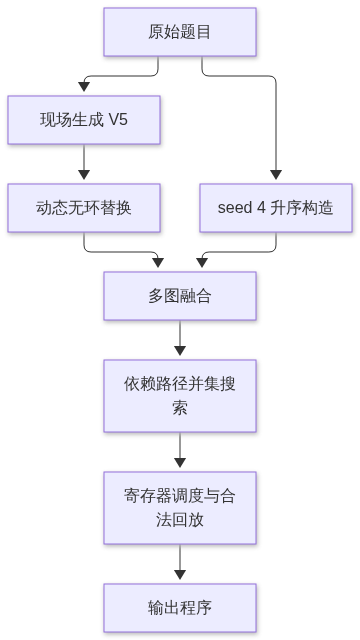
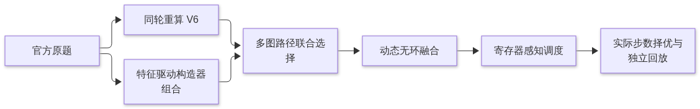
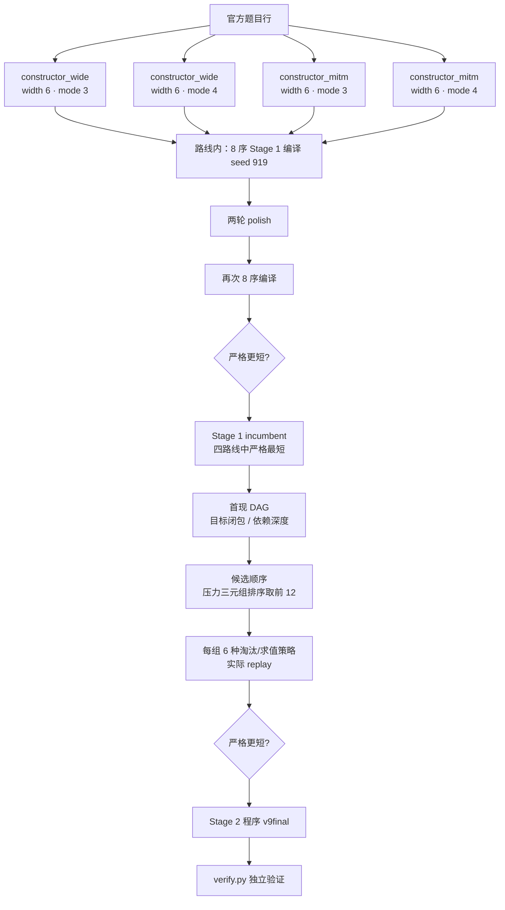
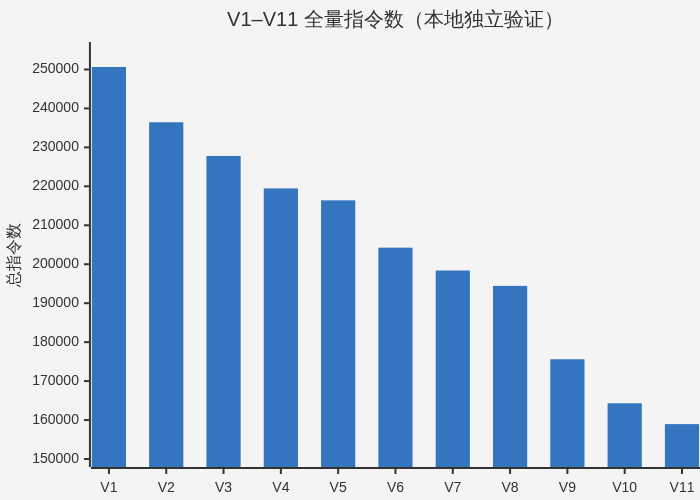
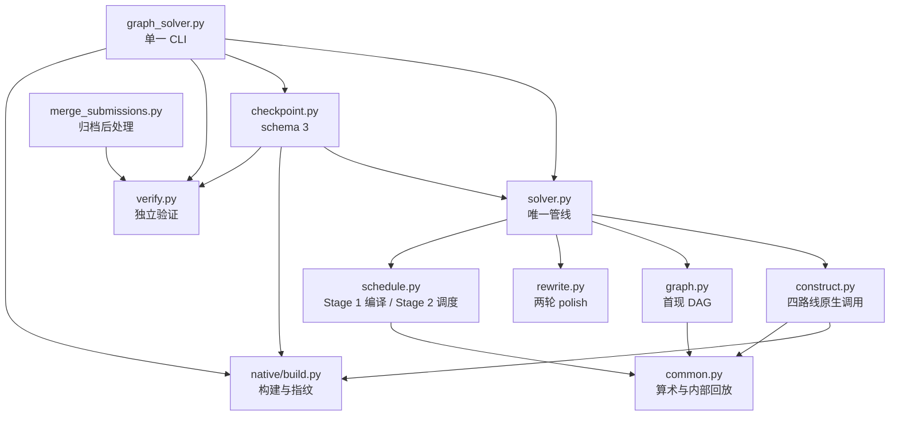

# Santa 2026 · 多目标算术程序：从构造到计算图优化

> 交互学习文档 · V9 当前发布版 / 功能化架构 + 冻结 V9 管线
>
> **阅读状态说明：** 本文对应 `feat/santa-v9` 上的 V9 正式发布：仓库只保留一套按职责组织的求解器（`algorithms/` 功能模块 + `native/` 两个冻结 C++17 构造内核），版本唯一权威是 `SOLVER_VERSION = "v9"`。V1–V8 历史实现固定在 [commit `9337a354`](https://github.com/Leonardo-F/kaggle-lab/tree/9337a3549bea09257cbf36ae1f8da2cbd452942b/competitions/santa-2026)，V8 功能化布局基线为 [commit `2875199`](https://github.com/Leonardo-F/kaggle-lab/tree/287519977aa85a19ef9e3074e6bfd2b9e578b5c3/competitions/santa-2026)；两者都可以用独立 worktree 复现，不再作为当前运行依赖。V8 等价重构记录（[v8-refactor.json](reports/v8-refactor.json)）是**历史验收**：文件存在时互动报告会与固定的 [v8.json](reports/v8.json) 对照展示，缺失时使用原始 V8 记录，不阻塞构建，也不进入正式版本曲线。

**核心问题：** 给定初值与目标集合，用有限寄存器和尽可能少的四则运算覆盖全部目标。我们的办法是先构造合法程序，再通过跨目标共享、全局路径选择、子图重写和寄存器调度压缩真实指令数。V9 改成"两个原生动态字典构造内核 + 四路线择优 + 两阶段寄存器调度"：V1 到 V9 的本地全量成绩从 **250,642** 降至 **175,604**（减少 75,038 步，约 29.94%），其中 V8 194,444 → V9 再省 18,840 步（9.689%）。174,884 是 V8 与 V9 两份独立结果的逐题后处理混合归档，不是算法版本，不计入这条曲线。以上都不是 Kaggle 榜单成绩，也不是全局最优证明。

## 学习导航

| 想了解什么？ | 跳转 | 建议时间 |
|---|---|---:|
| 赛题怎么玩？亲手执行指令 | [01 赛题与手算](#01-赛题与手算) | 5 min |
| 为什么用计算图？ | [02 数学模型](#02-数学模型) | 8 min |
| 怎样生成候选表达式？ | [03 构造搜索（历史）](#03-构造搜索) | 10 min |
| 怎样让多个目标共享计算？ | [04 全局图优化（历史）](#04-全局图优化) | 10 min |
| V8 为什么更强？ | [05 子图重写](#05-子图重写) | 10 min |
| 48 个寄存器如何限制算法？ | [06 寄存器调度](#06-寄存器调度) | 8 min |
| V9 为什么更强？ | [07 V9 动态字典构造与寄存器压力调度](#07-v9动态字典构造与寄存器压力调度) | 12 min |
| 从 V1 到 V9 的变化 | [08 演进与实验](#08-演进与实验) | 5 min |
| 如何阅读当前源码？ | [09 当前与目标架构](#09-当前与目标架构) | 5 min |
| 怎样从零复现？ | [10 复现与交互回放](#10-复现与交互回放) | 按需 |
| V10 还能优化什么？ | [11 局限与研究方向](#11-局限与研究方向) | 8 min |

**动手入口：** [离线模拟器](../src/simulator.html) · [独立互动报告](../Santa-2026-Interactive-Report.html) · [成绩与提交](../submissions/README.md) · [实验进展](progress.md) · [公开方案对比](frontier-analysis.md)。

本文的折叠练习使用 Markdown 支持的 HTML `details`，图示复用原有 `diagrams/` 中的 PNG；V9 章的新管线图只提供 Mermaid 源码块（互动报告不执行 Mermaid 渲染，阅读器不支持时以下方文字说明为准）。请将文件放在原 `docs/` 中，以保留相对链接；也可在下文直接读图注及算式。Markdown 本身不运行 Python 或 C++，不宣称可以直接求解新题；实际可执行的交互位于模拟器或 CLI。

---

## 01 赛题与手算

每题给定初始正整数列表 `starting_values`、目标列表 `targets`、数值上限 `value_limit`、寄存器数量 `registers`（正式题为 48）。程序每步读取两个已初始化寄存器，做加、减、乘或整除，将结果写到指定寄存器，允许覆盖操作数。结果必须为正整数且不超过上限；除法要求整除。目标只要曾经出现过即可，包括初值中的目标。单题最多 4,096 条指令，program 单元格最多 128 KiB。正式 1,000 题的指令数相加，越低越好。[Kaggle 题面](https://www.kaggle.com/competitions/santa-2026/overview) · [独立验证器](../src/verify.py)

指令 JSON 形式为 `[op, i, j, d]`，索引从 0 开始。先读 i、j 的旧值，后写 d。

### 练习 A：从 3 得到 9、27、81

初值 `R0=3`，上限 100。试着只用两个寄存器完成所有目标。

<details>
<summary>展开答案：3 步最优程序</summary>

| 步骤 | 指令 | R0 | R1 | 已完成目标 |
|---:|---|---:|---:|---|
| 0 | 初始 | 3 | 空 | 无 |
| 1 | `["*",0,0,1]` | 3 | 9 | 9 |
| 2 | `["*",1,0,0]` | 27 | 9 | 9, 27 |
| 3 | `["*",1,1,1]` | 27 | 81 | 9, 27, 81 |

```json
[["*",0,0,1],["*",1,0,0],["*",1,1,1]]
```

每条指令最多产生一个新目标；三个新目标至少三步，因此此程序达到下界。9 被覆盖仍算已命中。

</details>

### 练习 B：从 3、7 得到 100、103、107

初值 `R0=3, R1=7`，上限 120。分别计算三个目标，和共享同一个中间值，哪种更短？


<details>
<summary>展开答案：共享 10 与 100</summary>

| 步 | 算式 | 指令 |
|---:|---|---|
| 1 | 3+7=10 | `["+",0,1,2]` |
| 2 | 10×10=100 | `["*",2,2,2]` |
| 3 | 100+3=103 | `["+",2,0,0]` |
| 4 | 100+7=107 | `["+",2,1,1]` |

独立沿相同路线构造分别需 2、3、3 步，共 8 步；共享后只需 4 步。任何初值的一步运算均不能命中目标，故第一步至少需要准备一个中间值，再至少三步命中目标，四步最优。

</details>

[返回学习导航](#学习导航)

## 02 数学模型

### 2.1 真实目标：有限寄存器上的最短程序

记输入为 $\mathcal I=(\mathbf s,T,L,R)$，初值集合为 $S$，目标集合为 $T$。第 $k$ 条指令为 $p_k=(o,i,j,d)$。寄存器状态与已命中集合满足

```math
\begin{aligned}
z_k &= o(r_i^{(k-1)},r_j^{(k-1)}),\quad 1\le z_k\le L,\\
r_d^{(k)}&=z_k,\qquad r_h^{(k)}=r_h^{(k-1)}\quad(h\ne d),\\
H_0&=T\cap S,\qquad H_k=H_{k-1}\cup(T\cap\{z_k\}).
\end{aligned}
```

设 $\mathcal F(\mathcal I)$ 是符合全部规则并最终满足 $H_K=T$ 的程序集合，则

```math
K_R^\star(\mathcal I)=\min_{\pi\in\mathcal F(\mathcal I)}|\pi|,\qquad Q=\sum_{i=1}^{1000}|\pi_i|.
```

基本下界是 $K_R^\star\ge |T\setminus S|$；若新目标非空且没有任何初值的一阶合法运算能命中新目标，则还要至少多一步。

### 2.2 值依赖图：把程序压缩成共享结构

给每个非初值 $v$ 选择构造式 $v=o(a,b)$，得到有向无环图（DAG）。令依赖闭包 $D_G(v)$ 包含生成 $v$ 所必需的非初值节点及其自身：

```math
D_G(v)=\begin{cases}
\varnothing,&v\in S,\\
D_G(a)\cup D_G(b)\cup\{v\},&v\notin S,
\end{cases}
\qquad C(G)=\left|\bigcup_{t\in T}D_G(t)\right|.
```

若节点 $v$ 出现在 $m(v)$ 个目标闭包中，独立构造到共享构造的理想节省为

```math
\sum_{t\in T}|D_G(t)|-C(G)=\sum_{v:m(v)>0}(m(v)-1).
```

若已选择的依赖集合为 $U$，新目标 $t$ 的边际开销为 $|D_G(t)\setminus U|$。这比单看数值大小或表达式长度更贴近跨目标共享。

### 2.3 图更小，程序一定更短吗？

无限寄存器时，一个合法 DAG 可以按拓扑顺序每个有效节点计算一次。反过来，取任一合法程序中每个值首次出现时的构造式，即得到无环依赖图；去掉无用节点，其节点数不大于程序长度。故

```math
\min_{G\text{ 合法值图}} C(G)\le K_R^\star(\mathcal I).
```

有限寄存器中，同一图可能因活值过多而需要重算，甚至无法被当前编译器成功编译。因此 $C(G)$ 是搜索代理，不是正式分数，必须完整回放后比较 $|\pi|$。

<details>
<summary>思考题：目标 100 完成后是否可以立刻释放其寄存器？</summary>

从赛题规则看可以覆盖；但从后续依赖看，103 和 107 还要用到 100，提前释放可能迫使重算。必须区分“目标已达成”和“值已无未来用途”。

</details>

[返回学习导航](#学习导航)

## 03 构造搜索

目标是从题目本身生成多个可执行候选，而不是从已有答案出发。以下技术对应历史 V1–V7 的 Python 构造搜索，作为教学与 V8 之前的历史记录保留；**当前 V9 的 Stage 1 已改为两个原生 C++17 动态字典构造内核**（见 [V9 章](#07-v9动态字典构造与寄存器压力调度)），这些 Python 构造器不再是运行依赖。

### 3.1 多进制分解（V1）

对基数 $b>1$，欧几里得除法给出

```math
q=\lfloor t/b\rfloor,\quad r=t-bq,\qquad t=bq+r=b(q+1)-(b-r).
```

两种表达式分别从目标下方和上方逼近；若上方乘积超过 $L$ 则排除。对尚未构造的商继续递归分解。实现尝试多个固定基数、目标顺序与自适应候选池。

<details>
<summary>练习：已有 3、4、7、9、10，生成 347 和 349</summary>

先构造 30=3×10、34=30+4、340=34×10，再加 7 和 9，总共 5 步。共享 340 可避免重复三步；并不声称这是任意候选下的最优值。

</details>

### 3.2 反推操作数（V3）

枚举已知或已有构造方式的 $a$，反推出 $b$，用哈希表查询，而不必遍历全部 $(a,b)$ 对。

| 表达式 | b | 必要条件 |
|---|---|---|
| $t=a+b$ | $t-a$ | $t>a$ |
| $t=a-b$ | $a-t$ | $a>t$ |
| $t=b-a$ | $t+a$ | $b\le L$ |
| $t=ab$ | $t/a$ | $a\mid t$ |
| $t=a/b$ | $a/t$ | $t\mid a$ |
| $t=b/a$ | $ta$ | $b\le L$ |

每条还要验证 $1\le b\le L$ 和表达式合法性。固定目标、$M$ 个 a 时最多提出 $6M$ 个查询（不是整题算法的复杂度）。例如已知 13、欲得 91，可直接查询 7。

### 3.3 不局限于最近的商（V4）

固定基数 $b$，在已有值中查找标准商附近的廉价商 $\tilde q$：

```math
p=b\tilde q,\qquad \tilde r=|t-p|,\qquad t=p+\operatorname{sgn}(t-p)\tilde r.
```

当乘积尚未构造且余数非零时，边际成本为

```math
\left|\left(D_G(b)\cup D_G(\tilde q)\cup D_G(\tilde r)\cup\{p,t\}\right)\setminus U\right|.
```

已有乘积则复用；余数为零时无需额外加减。若 9、13 已可用，103=10×9+13 可能比标准商路线更便宜。核心是构造成本而非数值距离。

### 3.4 乘积池与模余数索引（V5）

从便宜因子生成乘积池，并查找 $t-p,p-t,p+t$ 等可组合的值。对选定基数 $b$，使用

```math
t=bq+\sigma r,\quad \sigma\in\{-1,+1\}\quad\Longrightarrow\quad r\equiv\sigma t\pmod b,\quad q=(t-\sigma r)/b.
```

每个选中基数的余数桶最多保留两个廉价乘积。只要商、乘积及运算合法，可以选择大于基数的余数。

| 目标 1003，基数 64 | 商 | 偏移 | 表达式 |
|---|---:|---:|---|
| 向下 | 15 | 43 | 64×15+43 |
| 向上 | 16 | 21 | 64×16−21 |
| 模桶 | 13 | 171 | 64×13+171 |

<details>
<summary>为什么第三条路线可能更好？</summary>

171 与 43 模 64 同余，若 171 已由 9×19 廉价得到且 13 已可用，就可能避免生成 43。扩大候选池并不保证更好：有限预算下排序会改变，历史 8 题消融也出现过退化。

</details>

### 3.5 自适应构造器组合（V7）

V8 的内部基线仍使用 V7 特征规则及 V5 构造器。令 $n=|T|$、$w_{\max}$ 和 $w_{\min}$ 为目标位宽最大/最小值。

| 条件 | 目标排序 | seed | width |
|---|---|---:|---:|
| 始终 | 数值升序 | 5 | 3 |
| n≥20，位宽跨度≥6 | 位宽降序，同宽数值升序 | 6 | 3 |
| n≥20，位宽跨度小于6 | 低字节 t mod 256 | 6 | 3 |
| n≥20，最大位宽≥40 | 数值升序 | 7 | 4 |
| n小于20，初值数≤2，最大位宽≥25 | 数值升序 | 7 | 4 |

默认至多取 3 个计划；候选均从本轮题目重新生成，回放验证后再加入当前候选集合。选择规则是启发式，未训练选择器。注意这里的 width 是构造器的搜索宽度参数，不是硬件寄存器位宽。

[返回学习导航](#学习导航)

## 04 全局图优化

本节 V2–V7 的全局图优化与路径联合选择是历史路线，用于解释 V8 之前跨目标共享的收益来源；当前 V9 没有 Python 侧的路径联合选择阶段，只在构造内核产出的值图上做两轮 polish（[7.4](#74-两轮图压缩polish)）。

### 4.1 依赖替换与引用计数（V2–V3）

同一数值可能有多个等价表达式。改写某个节点，只有旧依赖的最后一个引用消失时才能节省一个有效节点。令 $\rho_G(v)>0$ 表示节点仍被目标闭包使用，则

```math
\Delta C=\sum_{v\notin S}(\mathbf 1[\rho_{G'}(v)>0]-\mathbf 1[\rho_G(v)>0]).
```


例如原图用 110 产生 103 和 107，只改写一个目标并不能删除 110；两个目标都改为复用 100，110 才能剪枝。V2 六轮局部扫描并尝试多种求值顺序；V3 增加反查候选及最多 100 轮大邻域融合。各代方法在当时的运行中产生候选，而非读取前次提交。

### 4.2 动态无环替换（V6）

早期替换受值的发现顺序限制。V6 为已发现数值提出更多表达式，每次替换前沿当前依赖图判断环路，用引用计数维护活跃节点。节点搜索默认 180 轮；额外加入 seed=4 升序构造候选。本轮生成的程序是融合素材，不能替换为历史答案。

### 4.3 多图完整路径联合选择（V6–V7）

对每个目标 $t$，从各候选图提取完整见证路径 $p_t\in\mathcal P_t$，联合代理目标为

```math
\min_{p_t\in\mathcal P_t}\left|\bigcup_{t\in T}D_{t,p_t}\right|.
```

实现用 Python 整数 bitset 表示依赖集合，并集用按位或，成本用 `bit_count()`。先初始化及坐标搜索，再模拟退火选择路径。V6 默认路径选择 300 轮；V7 的多图路径选择 400 轮，扰动 1–8 个目标路径，温度由 3 降至 0.15，按 Metropolis 准则接受部分劣解。V7 还对最多两条最短候选执行额外动态融合（每次 120 轮）。最终编译、回放，按真实指令数保留最好合法程序。





<details>
<summary>练习：为什么每个目标分别选最短路径不一定最优？</summary>

设 A、B 的各自最短闭包大小均为 3，且彼此不交；另有各大小为 4 的路线，二者共享三个中间值。分别最短的并集成本为 6，第二组并集成本为 5，因此联合选择可能更优。这个例子只说明集合代理成本，不代表有限寄存器程序一定节省一步。

</details>

[返回学习导航](#学习导航)

## 05 子图重写

本章记录 V8 Final 的冻结管线（历史）。**V9 不再运行这套 Python 重写/组修复链**：当前图侧只有构造内核产出的值 DAG 与两轮 polish，随后进入 Stage 1 编译与 Stage 2 调度（[V9 章](#07-v9动态字典构造与寄存器压力调度)）。下列算法作为 V8 的研究证据和教学案例保留。

V8 Final 从本轮 V7 基线出发，先列表调度，再双运算重写、三运算重写、等成本探索、严格成组修复、等成本成组修复，最后做寄存器优化。冻结版本不包含开发期未进入最终管线的退火与其他额外构造实验。


### 5.1 双运算子图重写

删除只服务于节点 $v$ 的旧依赖（令 $R$ 为可移除节点集，$K$ 为保留节点集），枚举第 3.2 节的反推关系。如果另一操作数 b 已在保留图中，比较新增依赖与移除依赖；若 b 尚无构造，则可从两两运算池寻找 $b=o_2(c,d)$。示意增量（在新旧替换根节点成本相互抵消的计数约定下）为

```math
\Delta C=|(D(a)\cup D(b))\setminus K|-|R|.
```

若新增 b，则示意增量为 $1+|(D(a)\cup D(c)\cup D(d))\setminus K|-|R|$。实际代码依据完整闭包及环检测确认变化，不能用近似公式替代验证。两轮扫描后指令数从 198,374 降至 195,705，是 V8 最大阶段贡献。

### 5.2 三运算重写与等成本探索

进一步对可移除专属依赖至少为 3 的节点寻找组合构造：

```math
v=o_1(a,b),\qquad b=o_2(c,d).
```

输入候选来自保留图或两两运算池。每轮只重点处理删除收益最大的 10 个节点，按位宽桶取样，最多保留 8 个提案。严格阶段两轮将 195,705 降为 195,090；随后额外一轮等成本探索允许改变图结构，即使 $\Delta C=0$，并始终保留已经验证的最短程序，得到 194,881。

### 5.3 成组切断与修复（group repair）

一次选择 2–4 个互不依赖的节点作为切断集 $C$，冻结其余依赖 $F$，为每个 $v\in C$ 找新表达式候选 $A_v$。联合束搜索最小化

```math
\min_{e_v\in A_v}\left|F\cup C\cup\bigcup_{v\in C}D(e_v)\right|.
```


束宽 10；候选按依赖并集、补丁大小与确定性字典序排序去重，鼓励多个候选共享新中间值（排序折扣 0.8）。每轮尝试编译最好的三个补丁。严格阶段 6 轮，只接受活跃节点数下降的图更新；等成本阶段 8 轮，每三轮之一允许中间图增加 1 个活跃节点，并有相对初始图的增长上限。最终保留的仍是更短合法程序。两个阶段分别省 62 与 22 步。

<details>
<summary>等成本甚至暂时更大的图，为什么值得探索？</summary>

图结构变动可能创造新的共享中间值或降低寄存器压力。搜索中的探索状态和最终提交的 incumbent 是两个对象：前者可暂时不改善，后者始终保留已验证的最短程序。更开放的探索策略可在后续版本单独研究；V8 冻结记录与当前 V9 管线都不应因此改写。

</details>

### 5.4 搜索预算与复杂度

设当前有效节点数为 n，值池大小为 m。两两运算池的枚举规模至多 O(m²)，单轮双运算候选扫描约 O(nm+m²)（不包含所有闭包集合运算、编译及回放成本）。图闭包、编译和多轮搜索会带来额外开销，不能把候选数上界当作整题运行时间上界。

| 阶段 | 冻结预算 |
|---|---|
| 双运算 | 2 轮，候选 b 构造数量受限 |
| 三运算 | 2 轮，每轮预算 10 个节点，每节点至多 8 个提案 |
| 等成本探索 | 额外 1 轮 |
| 严格成组 | 6 轮，束宽 10，最多编译 3 个补丁/轮 |
| 等成本成组 | 8 轮，束宽 10，同上 |
| 最终调度 | 32 个候选顺序，优先完整编译压力较低的 8 个 |

[返回学习导航](#学习导航)

## 06 寄存器调度

以下 6.1–6.3 是 V7/V8 的历史调度器。当前 V9 使用另一套两阶段实现：Stage 1 的 `compile_graph`（8 个确定性顺序）与 Stage 2 的 `schedule`（首现 DAG、压力三元组、6 种淘汰策略），见 [V9 章](#07-v9动态字典构造与寄存器压力调度)；两者不是同一实现，V8 的 `schedule_v8`/`compile_graph` 不能直接套用到 V9。

固定图仍须决定拓扑顺序、寄存器分配及被覆盖值的重算。令 next(v) 表示下一次使用位置，已发射且仍有后续用途的活值集合为

```math
L_k=\{v:\ v\text{ 已发射且 }\operatorname{next}(v)>k\}.
```

### 6.1 V7：共享闭包聚类与 last-use overwrite

V7 枚举六种目标根顺序（原序、逆序、升序、降序、两种共享闭包聚类）、两种 DFS 子树次序、两种淘汰策略：distance 优先淘汰下一次使用最远的值；cost 比较 $(\operatorname{next}(v)-k)/(1+|D(v)|)$，并按下一次使用与数值打破平局。允许操作数在最后一次使用时原地覆盖。初值保护与失败回退按代码规则执行。

### 6.2 V8：列表调度重编译

V8 的首个额外阶段不改表达式，而尝试八种拓扑顺序：四种列表调度（释放寄存器优先、产生新值优先、闭包大小、随机优先级），以及四种目标顺序 DFS（原序、逆序、闭包小到大、闭包大到小）。每种顺序尝试分配寄存器，最后使用时覆盖，完整回放后只接受更短合法程序。全量仅省 14 步。

### 6.3 V8 Final：压力模型与重计算

最后生成 32 个候选根顺序，使用随机打乱、闭包大小排序、共享闭包聚类、随机交换等策略。轻量模型按以下三元组排序：

```math
\operatorname{pressure}(\pi)=(\text{溢出步数},\text{峰值活值数},\text{活值面积}).
```

优先完整分配压力最小的 8 个；淘汰考虑下一次使用距离、剩余闭包成本，支持最后使用覆盖。实际回放选择最短合法程序，节省 353 步。这些启发式不是寄存器调度的全局最优证明。

<details>
<summary>练习：如果只允许两个寄存器，会发生什么？</summary>

重新查看练习 A，两个寄存器已足够，因为 3 在第 2 步最后使用，9 在第 3 步最后使用。练习 B 的四步方案用了第三个寄存器保存 10/100；当只剩两个寄存器时，需要重新寻找可行程序，而不是直接把寄存器编号 2 改为 0 或 1。真实程序取决于可重建值与活值生命周期。

</details>

[返回学习导航](#学习导航)

## 07 V9：动态字典构造与寄存器压力调度

V9 替换了 V8 的"Python 构造 → 图重写 → 寄存器优化"整条管线：Stage 1 用两个冻结的 C++17 原生构造内核（`native/constructor_wide.cpp`、`native/constructor_mitm.cpp`）生成值 DAG，按四条路线择优；Stage 2 只在这份程序的首现 DAG 上重排求值顺序与寄存器，尽量缩短真实指令数。两条阶段指标是 `v9_stage1` 与 `v9final`；本机从官方 1,000 题独立复跑得到 **182,205 → 175,604** 步。内核的搜索策略是冻结研究源码，本仓库只移植调用、严格协议解析、图改写与两阶段调度。



**不支持 Mermaid 的阅读器：** 官方题目行 → 四条原生构造路线 → 每路线先做 Stage 1 编译，再经两轮 polish 重新编译，取严格更短者 → 四路线中取严格最短的 Stage 1 程序 → 从该程序提取首现 DAG → 生成候选顺序并按压力排序 → 对前 12 个顺序各尝试 6 种淘汰/求值策略，每次实际回放 → 只接受严格更短的调度 → 独立验证。冻结管线**没有** LNS、全局锚点或大整数构造阶段。上图只作为 Mermaid 源码块展示，本文没有渲染对应 PNG。

### 7.1 四条路线与两个原生内核

冻结路线严格按下面的顺序执行，全部完成才进入 Stage 2：

| # | 路线（`kernel:width:mode`） | 内核 | width | mode |
|---:|---|---|---:|---:|
| 1 | `constructor_wide_polish 6:3` | `constructor_wide` | 6 | 3 |
| 2 | `constructor_wide_polish 6:4` | `constructor_wide` | 6 | 4 |
| 3 | `constructor_mitm_polish 6:3` | `constructor_mitm` | 6 | 3 |
| 4 | `constructor_mitm_polish 6:4` | `constructor_mitm` | 6 | 4 |

每条路线的处理是：

1. 用对应内核和 width/mode 从题目行**重新构造**一张值 DAG；
2. 用 Stage 1 编译器 `compile_graph` 按 8 个确定性顺序生成合法程序（seed 919）；
3. 做两轮 polish 图压缩；
4. 对压缩后的图**再次**编译，若严格更短就替换该路线候选，否则保留第一次的程序；
5. 回放记分；四路线中只有**严格更短**才替换同轮 incumbent，等长时保留先到路线。

某条路线失败会记录错误并继续其他路线；只要有一条路线给出合法程序，该题就能继续，四条全部失败才报错，不会从历史 CSV 或检查点补答案（本次正式 1,000 题最终全部得到合法程序）。

两个内核共享大部分骨架：`mt19937_64` 种子 **1909**；对每个目标做**反向递归搜索，默认深度 5**；每个值在字典中最多保留 **3 条表达式**，取叶子时使用首条；中间乘积用 `__int128` 计算以避免 `long long` 溢出。差异只在候选分裂的搜索范围，见 7.2 与 7.3。

内核的输入协议是 `argv: <binary> <width> <mode>`，stdin 为 `limit count_start count_target start... target...`；stdout 第一行是节点数，随后每行 `value op left right`，按依赖后序输出。Python 端逐行检查整数、运算恒等式、范围、重复生产者、依赖顺序与目标覆盖；协议畸形直接报错，绝不"修补"成候选。超出 signed 64 位或非正整数的输入被明确拒绝。

### 7.2 动态可达值字典与逆向残差搜索（constructor_wide）

内核从本题初值出发构建一个**有限的多表达式字典**，它不是完整可达值空间：每个值最多 3 条表达式，已知值与"可一步物化"的值分开记录。种子步骤（按代码顺序，值已存在则跳过）物化稠密的小整数，让后续残差搜索有便宜的起点：

1. `1 = s0 / s0`（若 1 不在初值中）；
2. 2..16 逐个物化：优先用字典中的一步表达式，否则 `v = (v-1) + 1`；
3. 2 的幂：从 32 开始倍增，`mode>=3` 到 256，否则到 65536。

之后每加入一个新节点，就把它与所有活跃值做加、减、乘、整除（含两种减/除方向）扩充字典。

**一步反查。** 对目标 v 先扫"一步可达"关系，复用 [3.2 节](#32-反推操作数v3)的六种反推：`v-a`、`a-v`、`v+a`（用减法）、`v/a`（乘法）、`v*a`（除法）、`a/v`（除法），并检查每个操作数是否已在已知集合或字典中。若候选依赖不超过 2 个就提前接受。

**逆向残差分裂。** 一步不成时，把目标拆成"已知乘数 a × 商 q + 残差 r"：

```math
t=a q+r,\qquad q=\left\lfloor t/a\right\rfloor,\quad r=t\bmod a,
```

同时尝试非标准残差（商向上取整）：

```math
t=a(q+1)-(a-r),\qquad 0<r<a.
```

乘数 a 来自 `probes/bases`：当前已知值，加上按位宽分桶的字典采样（每桶最多 18 个均匀采样；`mode` 非零时每桶再随机抽 10 个）。分裂代价是启发式估计，越小越先递归：

```math
\operatorname{cost}(a,q,r)=
\mathbf 1_{a\notin K}+\mathbf 1_{r>0\land r\notin K}+\mathbf 1_{aq\notin K}+\mathbf 1_{r>0}
+\begin{cases}
\mathbf 1_{q\notin K}, & q \text{ 可由字典一步物化},\\
\max\left(2,\ 0.19\,(\operatorname{bits}(q)-7)\right), & \text{否则按进位链估算}.
\end{cases}
```

其中 $K$ 是已知值集合，$\operatorname{bits}(q)=64-\operatorname{clz}(q)$。按 cost 排序后最多展开 `width` 个互不相同的分裂；先递归构造 q（深度减 1），再依次补 a、乘积 $aq$（若字典已有则直接取）与最终一步。递归带 memo；没有候选时退化为固定基数 fallback（$v<256$ 用 16，否则用 256；若 $a\ge v$ 则改用 2，再递归拆商与余数）。深度 5 与 width 6 都是冻结上限；depth=5 时还会把所有字典键加入分裂基底扫描，扩大候选范围。

**小例子：** 初值 `{3, 7}`、上限 120、目标 103。种子先物化 1=3/3 与 2..16（10 可由 3+7 进入字典并物化）。取乘数 a=10：q=10、r=3，10 已物化、3 是初值，只新增 `100=10×10` 与 `103=100+3` 两个节点。这里的关键不是"乘积形式"本身，而是 a 与 r 的选择在构造期就按代价排序，不需要先有 V8 那样的完整候选图。

注意：字典每值最多 3 条表达式、probes 每桶样本有限、递归深度固定 5、width=6，因此这是**有界局部搜索**；它不保证全局最优，也不等于枚举全部可达值。

### 7.3 MITM 商邻域（constructor_mitm）

`constructor_mitm` 与 wide 的差异只在候选分裂的搜索范围：在递归 depth≥4 的阶段增加**全字典商邻域匹配**。对每个基底 a 与商 $q=\lfloor v/a\rfloor$，在已排序的全值表 V（已知值 + 字典值）中用二分定位 q，取 q 附近窗口（源码为位置 `pos-5 .. pos+5`，最多 11 个候选 b）。对每个 b 计算乘积与残差：

```math
p=a b,\qquad r=|p-v|,\qquad t=
\begin{cases}
p-r, & p>v,\\
p+r, & p\le v.
\end{cases}
```

合法条件是 $1\le p\le L$、$p\ne v$、$r\ne v$（避免自依赖）。通过检查时把 $(a,b,r,\pm)$ 作为一个分裂候选，交给与 wide 相同的代价排序与递归构造。

**这不是穷举四元组：** 这里的 "MITM" 指用乘积/商邻域把目标拆成"已知值 × 商附近的字典值 ± 残差"，而不是枚举所有 $(a,b,c,d)$ 组合。它只扫描有界的 bases 集合，并对每个 q 看至多 11 个邻域值；用二分定位后复杂度约为 $O(|\text{bases}|\cdot\log|V|\cdot 11)$，远小于四元组穷举。它也不保证覆盖所有可行分解。

**例子：** v=1003、a=64、q=15；q 的邻域含 16，于是 p=64×16=1024、r=21，得到 `1003 = 1024 − 21`。若 1024 与 21 都便宜（字典命中或由已有值一步得到），这条路线可能比 `64×15+43` 更省；也可能更差，最终由代价排序和回放决定。

### 7.4 两轮图压缩（polish）

构造出的图里可能有"独占依赖子树"：只被当前值 v 使用的祖先集合 $R(v)$。polish 尝试用更小的后缀表达式重建 v，从而删掉 $R(v)$ 中不再需要的节点。对候选新表达式 e（直接一步反推，或经两两运算池引入一个辅助值 b 的两步构造），增益为

```math
\operatorname{gain}(v,e)=\left|R(v)\right|-\left|D(e)\setminus F\right|,
```

其中 $F$ 是活跃节点中不属于 $R(v)$ 的固定部分，$D(e)$ 是新表达式的依赖闭包。只接受 $\operatorname{gain}>0$ 的补丁并原地改图。每轮按独占依赖子树大小降序**只评估前 20 个活跃值**，共 **2 轮**；两轮后重新编译，只有严格更短才替换该路线的 Stage 1 程序。polish 是受限局部改写：候选来自"已有值一步反推 + 两值池一步中转"，不改变闭包外的结构，不保证最优。

### 7.5 Stage 1 编译：8 个确定性顺序

`compile_graph` 对给定值 DAG 尝试 8 个确定性拓扑/DFS 顺序（seed 919），每次都真正生成指令并回放验证。顺序差异来自：

- **目标根顺序**：`turn % 4` 为 0 用原序、1 用逆序、2 按闭包大小排序（`turn % 8 == 6` 时降序）、3 用 `Random(919)` 打乱；
- **操作数次序**：每个节点的两个操作数按闭包大小交换，交换方向随 `turn % 2` 变化；
- **寄存器分配**：优先最小空闲寄存器；无空闲时在当前指令的受保护集合之外淘汰"下一次使用最远"的值，rank 为 `(下一次使用距离)/(turn % 2 ? 1+闭包大小 : 1)`，再按距离、负闭包大小、值打破平局；
- **回放**：失败即丢弃该顺序；某个顺序的指令数达到 DAG 节点数下界时提前停止。

返回值是 `(最短合法程序, 最后一次执行的 order 长度)`。第二个返回值保留了冻结研究的指标语义：它是**最后一次尝试的 order 长度**，不总是返回程序本身的长度；**四路线明细里的 `nodes` 沿用了这一语义**，不能把它当作精确节点数。顶层指标 `nodes` 不是这个值，而是 Stage 2 首现 DAG 的节点数（固定 DAG 下界，见 7.6）。

### 7.6 Stage 2：首现 DAG、压力三元组与淘汰策略

Stage 2 只做一件事：在 Stage 1 程序语义不变的前提下重排同一值图的求值顺序与寄存器分配，压缩真实指令数。

1. **首现 DAG**：回放 Stage 1 程序，每个值只保留第一次产生它的表达式，得到无环值图；由它计算目标闭包 $C(v)$、依赖深度与拓扑序。
2. **下界提前退出**：DAG 节点数 `nodes` 是"每个非初值节点至少一条指令"的松弛下界。若 Stage 1 程序已经等于 `nodes`，直接返回，不再搜索。
3. **候选顺序**：初始顺序包括 6 种根顺序 × 2 种 DFS 操作数方向、3 个种子 × 3 种共享闭包聚类指标 × 2 方向、8 种贪心列表调度（按释放寄存器、产生新值、复用上次依赖、解锁后继等优先级）、以及 32 次根置换搜索（随机交换目标根，重算压力，接受不劣压力）。去重后按压力排序。
4. **压力三元组**（轻量模型，不跑完整 emit）：

```math
\operatorname{pressure}(\pi)=(\operatorname{overflow},\operatorname{peak},\operatorname{area}),
\quad
\operatorname{overflow}=\sum_k\max(0,|L_k|-R),
\quad
\operatorname{peak}=\max_k|L_k|,
\quad
\operatorname{area}=\sum_k|L_k|,
```

其中 $R$ 是寄存器数、$L_k$ 是第 k 步的活值集合。按三元组字典序排序，取**前 12 个**顺序真正生成程序。

5. **6 种淘汰/求值策略**：每组 `(顺序, mode)` 都实际 emit 并 replay：
   - 操作数已无后续用途时直接用其寄存器覆盖（last-use overwrite）；
   - 否则优先用空闲寄存器；仍不够时在受保护集合外按 3 种代价模型淘汰：`next`、`next/cost`、`next/√cost`，其中 `cost(x)=|C(x)\setminus L|+1` 是重算 x 的闭包开销；
   - 操作数次序可按"闭包缺口"交换（`mode % 2`）。
6. **真回放择优**：只有实际回放后**严格更短**才替换 incumbent；生成过程中一旦指令数达到 `len(best)` 就提前放弃该候选；某候选达到 `nodes` 即提前停止。

顺序生成与置换搜索使用 seed **202609**。Stage 2 只在固定 Stage 1 DAG 上重排，不能改变表达式选择；因此 `nodes` 只是**该 DAG 的下界**，不是理论可达的全局指令下界，调度本身也不是最优的。

### 7.7 冻结参数与边界

| 环节 | 冻结参数 |
|---|---|
| 原生内核 | RNG 1909；反向递归深度 5；每值最多 3 条表达式；leaf 取首表达式；种子 1、2..16、2 的幂（mode≥3→256，否则 65536） |
| 四路线 | `wide 6:3 → wide 6:4 → mitm 6:3 → mitm 6:4`，严格更短才替换，等长保留先到 |
| Stage 1 编译 | tries=8，seed=919；回放验证；达到 DAG 节点下界提前停止 |
| polish | rounds=2，每轮只评估 top 20 活跃值 |
| Stage 2 调度 | seed=202609，根置换搜索 32 次，压力排序取 top 12，每组 6 种淘汰/求值策略 |
| 版本与配置 | `SOLVER_VERSION="v9"`；`v9_stage1` / `v9final` 两个阶段键；`routes`、`nodes`、`schedule_attempts` 逐题记录 |

边界与不保证项：

- Stage 1 只比较**四条已构造路线**，不保证这四条之外没有更好的构造；
- Stage 2 只重排固定 DAG，不做 LNS、全局锚点或大整数构造；
- 调度与构造都是启发式，**全局最优未知**；报告里的 `nodes`（固定 DAG 下界）不是理论可达的全局指令下界；
- 没有 V10；所有数字都是本地独立验证的指令总数，不是 Kaggle 榜单成绩。

[返回学习导航](#学习导航)

## 08 演进与实验

### 8.1 同一批 1,000 题的本地成绩



> **图表口径：** 这张 PNG 由 `diagrams/version-scores.mmd`（xychart）生成，只覆盖 V1–V5。本环境没有离线 Mermaid 渲染器，因此本次只把 `.mmd` 源文本补到 V1–V9，**没有重绘 PNG**。V6–V9 的正式成绩以互动报告顶部的动态成绩条和本节表格为准，两者都直接来自 `docs/reports/v1.json`–`v9.json`。

| 版本 | 核心贡献 | 指令数 | 较前代少 | 改善 / 持平 / 退化 | 独立验证记录 |
|---|---|---:|---:|---|---|
| V1 | 多进制、自适应构造 | 250,642 | — | — | [1,000/1,000](reports/v1.json) |
| V2 | 宽搜索与依赖压缩 | 236,449 | 14,193 | 829/171/0 | [1,000/1,000](reports/v2.json) |
| V3 | 反推查找、联合融合 | 227,799 | 8,650 | 734/266/0 | [1,000/1,000](reports/v3.json) |
| V4 | 廉价邻近商 | 219,462 | 8,337 | 723/277/0 | [1,000/1,000](reports/v4.json) |
| V5 | 乘积池与模余数 | 216,404 | 3,058 | 416/584/0 | [1,000/1,000](reports/v5.json) |
| V6 | 动态无环、路径联合 | 204,255 | 12,149 | 799/201/0 | [V6 报告](reports/v6.json) |
| V7 | 多构造器、调度 | 198,388 | 5,867 | 717/283/0 | [1,000/1,000](reports/v7.json) |
| V8 Final | 子图重写、组修复、寄存器 | 194,444 | 3,944 | 775/225/0 | [1,000/1,000](reports/v8.json) |
| V9 | 动态字典构造与寄存器压力调度 | **175,604** | 18,840 | 833/30/137 | [1,000/1,000](reports/v9.json) |

**V9 阶段对照（同一批 1,000 题，从官方题目独立复跑）：** V8 194,444 → V9 Stage 1 **182,205** → V9 Stage 2 **175,604**。Stage 2 只在 Stage 1 程序的首现 DAG 上重排调度，再省 **6,601** 步（相对 Stage 1 的 3.6228%），**394 题改善 / 606 持平 / 0 退化**；相对 V8 是 **833 改善 / 30 持平 / 137 退化**，共少 **18,840** 步（9.689%）。V9 最长程序 **415** 步（V8 为 535）。注意 V9 的 Stage 1 并非全面优于 V8：在低位宽桶上略差，收益来自动态字典构造在中位宽档的改进，以及 Stage 2 在高位宽档的调度压缩。

**按目标位宽分桶**（定义与冻结报告一致：取每题目标位宽的中位数，偶数个时取中间两数平均后向下取整，再 `//10*10`；列依次为 题数 / V8 / V9 Stage 1 / V9 Stage 2 / Stage 2 节省 / Stage 2 改善题数）：

| 位宽桶 | 题数 | V8 | Stage 1 | Stage 2 | Stage 2 节省 | Stage 2 改善题数 |
|---|---:|---:|---:|---:|---:|---:|
| 0 | 17 | 76 | 78 | 78 | 0 | 0 |
| 10 | 123 | 7,580 | 7,610 | 7,610 | 0 | 0 |
| 20 | 224 | 28,393 | 25,996 | 25,996 | 0 | 0 |
| 30 | 251 | 49,607 | 44,429 | 43,753 | 676 | 89 |
| 40 | 228 | 56,337 | 52,115 | 49,992 | 2,123 | 159 |
| 50 | 141 | 45,847 | 45,630 | 42,579 | 3,051 | 130 |
| 60 | 16 | 6,604 | 6,347 | 5,596 | 751 | 16 |

50+ 位（50 与 60 桶）合计节省 **3,802 / 6,601 = 57.6%**：调度收益明显集中在程序更长、寄存器压力更大的题上。该表与冻结研究包 `v9_stage2_full_report.json` 的 `bit_width_buckets` 完全一致。

V1–V5 原复跑耗时分别为 156.5、285.5、424.8、624.2、640.6 秒（多版本并行，V5 6 个工作进程，其余 4 个，不是严格等资源 benchmark）。V7 与 V8 的 9 进程复跑分别为 878.73 与 1,174.13 秒。V7 最长 564 步；V8 最长 535 步；V9 最长 415 步。历史记录中 V6 以及各代复跑的配置以原报告为准；所有表格均为既有历史证据，不是本次重构后的测量。

例题 `scored_0626` 在 V1–V5 为 275→273→258→256→249；`scored_0289` 为 28→28→27→27→27。历史早期 285,288→272,748、269,369→263,575 属不同实验，不能并入同一独立版本曲线。[历史进展](progress.md)

### 8.2 各代全量阶段贡献

| 版本 | 过程与全量指令数 |
|---|---|
| V2 | 250,642 → 宽搜索239,693 → 图压缩236,449 |
| V3 | 236,449 → 反查228,527 → 融合227,799 |
| V5 | 219,462 → 构造217,279 → 融合216,404 |
| V6 | 216,404 → 无环搜索215,938 → 额外候选/融合205,959 → 路径联合204,255 |
| V7 | 204,255 → 自适应构造200,987 → 路径并集200,034 → 动态融合199,675 → 调度198,388 |
| V9 | 182,205（四路线 Stage 1 取最短）→ 175,604（Stage 2 首现 DAG 调度） |

V6 路径联合额外改善 125 题。V7 的阶段合计改善 5,867 步，约 2.8724%。V9 的 Stage 2 改善 394 题、省 6,601 步（相对 Stage 1 的 3.6228%）。这些阶段属于各自实验报告：V9 的两个阶段键是按定义累加的实际程序长度（Stage 1 是四路线中已编译程序的最短者，Stage 2 是调度后的最终程序），不是同一序列的消融阶段，不能与 V8 八阶段增量直接相加，也不等于所有模块在相同计算预算下的独立因果贡献。

### 8.3 V8 八阶段完整消融记录

| 阶段指标键 | 阶段 | 总指令数 | 增量减少 |
|---|---|---:|---:|
| `v7` | 同轮基线 | 198,388 | — |
| `list_schedule` | 列表调度 | 198,374 | 14 |
| `v8` | 双运算子图重写 | 195,705 | 2,669 |
| `v81` | 三运算子图重写 | 195,090 | 615 |
| `v82` | 等成本探索 | 194,881 | 209 |
| `v8group_strict` | 严格成组重构 | 194,819 | 62 |
| `v8group_neutral` | 等成本成组重构 | 194,797 | 22 |
| `v8final` | 最终寄存器优化 | **194,444** | 353 |

双运算重写贡献约 67.7% 的 V8 增量节省（2669/3944）。全量减少 1.988%（相对 V7）。这些是同一轮运行的逐题阶段指标累加；不能拼接不同配置的最优子成绩。

### 8.4 历史样本消融（折叠阅读）

<details>
<summary>展开 V3–V8 样本实验及限制</summary>

| 研究样本 | 记录 | 说明 |
|---|---|---|
| V3，24 题 | 6,941→6,537 | 22 改善、2 变长；[报告](reports/v3-handoff-ablation.json) |
| V4，24 题 | 6,473→6,310→6,290 | 基线→新增候选→融合；[历史版本](https://github.com/Leonardo-F/kaggle-lab/blob/35a688db3a01182d07d1ae2000a75f3191e1b57e/competitions/santa-2026/docs/algorithm-evolution.md) |
| V5，8 题 | 1,855→1,863→1,863→1,850 | 扩池、双乘积、模余数；[报告](reports/v5-handoff-ablation.json) |
| V6，100 题 | 22,653→22,602→21,492→21,476→21,298 | 非均匀随机开发样本 |
| V7，60 题 | 11,460→11,249→11,231→11,192→11,150 | 从排除开发样本的900题抽取，Random(707)，45改善15持平，155额外候选合法，126.47秒（4进程） |
| V7，12 题 | 2,306→2,305 | retain-v6-graphs 增益很小，默认关闭 |
| V8，100 题 | 20,862→20,570 | V8.0可比样本 |
| V8，60 题 | 13,142→12,914 | V8.2可比样本 |
| V8，28 题 | 6,089→5,977 | 冻结管线，23改善5持平，123.81秒 |

样本来自不同实验或分层采样，不能相互直接比较，也不能当作全量分数。原始证据、参数与耗时详情以[原文固定版本](https://github.com/Leonardo-F/kaggle-lab/blob/9337a3549bea09257cbf36ae1f8da2cbd452942b/competitions/santa-2026/docs/algorithm-evolution.md)及 reports 为准。

</details>

### 8.5 复跑证据

V7 的归档 CSV SHA-256：`0bd4c26ac3ba32c5fb6aced54e14e6269fde836dbfe671f51cbdb116eb7dacef`。

V8 的归档 CSV SHA-256：`6f15091bcfddf4335f69126c2088696dfa7a9a3fcb9c4de6dbaa448aca1279fd`。

既有复跑记录中，两版各自与交接 CSV 逐字节一致，SQLite `PRAGMA integrity_check` 为 `ok`，1,000 记录全部重放通过。来源：[V7 报告](reports/v7.json)、[V8 报告](reports/v8.json)。

2026-11-25 的功能化等价重构再次从官方题目独立求解正式 1,000 题：**194,444 步**、1,000/1,000 合法、最长 535 步，八阶段总分为 **198,388 → 198,374 → 195,705 → 195,090 → 194,881 → 194,819 → 194,797 → 194,444**。生成的 CSV 与归档 V8 **逐字节一致**（SHA-256 `6f15091bcfddf4335f69126c2088696dfa7a9a3fcb9c4de6dbaa448aca1279fd`），775 题改善、225 题持平、0 题退化。冻结基线另一次全量复跑用于逐题八阶段指标对照。命令、输入哈希、逐题比较、测试和耗时的完整记录见[重构报告](reports/v8-refactor.json)；该报告是**历史验收**，只与固定的 [v8.json](reports/v8.json) 对照，不随当前最佳版本改变。

**V9（2026-11-26，独立全量复跑）：** 从官方 1,000 题用全新 SQLite 检查点（schema 3，无 resume）独立求解：**175,604 步**、1,000/1,000 合法、最长 415 步；Stage 1 为 182,205、Stage 2 省 6,601；394/606/0；相对归档 V8 为 833/30/137，共省 18,840 步（9.689%）。环境为 Apple Clang 21.0.0（C++17、`-O3`，通过 `native/compat/bits/stdc++.h` 兼容头）+ Python 3.13.2，6 个进程，`session_elapsed_seconds` 约 443.85 秒。输出 CSV SHA-256 为 `05e7b630f9b9a26889a74e09dbc1317ece799e5d28d948ce28c02b99b0660cb8`。

冻结研究包的全量 CSV SHA-256 为 `5ab0b72c170272591f4d9485730b9805c82d9b2b857827bc017ab53ca3f3ce63`。**两者不是逐字节相同**：逐题程序 **999 / 1,000 相同**，唯一差异题 `scored_0775` 的两版程序等长（均为 181 步）但寄存器选择不同；两阶段总分、逐题分数、节点数、调度尝试数与按位宽选择桶全部一致。用冻结研究源码在本机重新编译运行，得到与移植版完全相同的程序，因此该差异归因于本机 Apple Clang 21 与冻结记录的 Linux GCC 工具链在等分候选平局时的顺序差异，不是移植逻辑差异；本文不声称逐字节复现冻结记录。完整记录见 [v9.json](reports/v9.json)，原始研究证据（archive、全量报告、逐题对照 CSV、运行日志哈希）见 [v9-stage2-ablation.json](reports/v9-stage2-ablation.json)，原始研究耗时不能与本机复跑直接比较。

练习 200 题独立复跑为 **36,045 步**、200/200 合法、最长 413、Stage 1 为 37,742、Stage 2 省 1,697（86 改善 / 114 持平 / 0 退化），约 131.15 秒；V8 重构报告记录的练习成绩为 40,207 步。练习题是独立数据集，不能与正式 1,000 题混算或拼成同一条曲线。

[返回学习导航](#学习导航)

### 8.6 混合归档：174,884 步（不计入版本曲线）

把两份**独立**结果逐题取较短程序（等长取 V9），可得到 **174,884 步**、最长 392 步：137 题取 V8、863 题取 V9（其中 30 题等长，按平局取 V9），比独立 V9 再省 720 步。该结果由后处理工具 [merge_submissions.py](../src/merge_submissions.py) 生成：先用 [verify.py](../src/verify.py) 完整验证两份输入，再按题号对齐、解析 JSON 程序并按 `len(program)` 取短，平局取第二个输入，最后对输出再做一次独立验证并原子发布。

它是归档后处理，**不是算法版本**：不参与求解、不被求解器/CLI/检查点引用、不进入正式独立版本曲线，`submissions/latest.json` 仍只指向独立 V9。归档 CSV 为 [elf-calculator-merged-v8-v9-score-174884.csv](../submissions/elf-calculator-merged-v8-v9-score-174884.csv)（SHA-256 `fe973ac4ed3ec8a587e18ce31b922daae4ec1060ad2bdc511d2130960978942a`），报告为 [v8-v9-merged.json](reports/v8-v9-merged.json)。与用户上传的参考混合文件相比 999 / 1,000 程序相同；差异同样是 `scored_0775` 的等长寄存器选择，参考文件不是求解输入。

```bash
python3 src/merge_submissions.py data/puzzles.csv \
  submissions/elf-calculator-independent-v8-score-194444.csv \
  submissions/elf-calculator-independent-v9-score-175604.csv \
  -o experiments/v8-v9-merged.csv --expect-score 174884
python3 src/verify.py data/puzzles.csv experiments/v8-v9-merged.csv
```

[返回学习导航](#学习导航)

## 09 当前与目标架构

### 9.1 为什么历史上需要多个版本？

在基线提交 `9337a354` 中，`v8.py` 仅转发 `v8_group.optimize`；group 调用 three、rewrite、register，rewrite 从 V7 重新生成候选，V7 依赖 V5/V6，V6 依赖 V5，V5 依赖 V3/V4。V1/V2 文件独立于 V8 调用链，但 V3 内部的早期构造策略仍参与重构后的 V8 运行。等价重构先迁移实际调用的每个阶段，再用同一批题目逐题确认程序与阶段指标不变，最后才删除版本文件。旧实现保存在 Git 历史中，不再作为 main 的运行依赖。

### 9.2 现状：按功能而不是版本管理



**不支持 Mermaid 的阅读器：** CLI 调用唯一 solver；solver 依次使用 construct、graph、rewrite、schedule 模块；construct 通过 native/build.py 构建并调用两个内核；checkpoint 绑定 solver 配置、native 构建与验证器；verify 独立于求解；merge 只做归档后处理。V8 的 `schedule_v8`/`compile_graph`/重写链不在当前调用图中。

| 当前文件 | 职责 | 说明 |
|---|---|---|
| [common.py](../src/algorithms/common.py) | 共享算术、内部 replay 合法性检查、程序大小限制 | 不含搜索策略；最终合法性仍由独立 `verify.py` 把关 |
| [construct.py](../src/algorithms/construct.py) | 四路线原生构造调用、严格协议解析、超时与错误分类 | 只从题目行构造，不读历史答案；输入超出 signed 64 位明确拒绝 |
| [graph.py](../src/algorithms/graph.py) | 从 Stage 1 程序提取**首现 DAG** | Stage 2 的输入；起始值是种子节点 |
| [rewrite.py](../src/algorithms/rewrite.py) | 冻结的两轮 polish 图改写 | 有界局部改写，不保证最优 |
| [schedule.py](../src/algorithms/schedule.py) | Stage 1 八序编译 `compile_graph` 与 Stage 2 压力调度 `schedule` | 两个调度器刻意分开，不假设等价 |
| [solver.py](../src/algorithms/solver.py) | 唯一公开管线 `solve`、`SOLVER_VERSION`、`DEFAULT_CONFIG`、`STAGES`、阶段指标 | 顺序即冻结顺序：四路线 → Stage 1 → Stage 2 |
| [native/constructor_wide.cpp](../src/algorithms/native/constructor_wide.cpp) | 动态可达值字典 + 逆向残差构造内核 | 冻结研究源码，字节一致；不重写搜索策略 |
| [native/constructor_mitm.cpp](../src/algorithms/native/constructor_mitm.cpp) | 同上并增加全字典商邻域匹配内核 | 冻结研究源码，字节一致 |
| [native/build.py](../src/algorithms/native/build.py) | 求解前原生构建、编译器探测、manifest 指纹、锁与 smoke test | 输出到 git-ignored 的 `experiments/native-build/` |
| [native/compat/bits/stdc++.h](../src/algorithms/native/compat/bits/stdc++.h) | 无 libstdc++ 聚合头编译器的兼容转发头 | 只在探测确认缺失时加入 include path，不改变算法行为 |

算法目录之外的工程组件：[graph_solver.py](../src/graph_solver.py) 是唯一 CLI（默认版本 v9、输出不覆盖、断点参数、求解前 preflight 原生构建）；[checkpoint.py](../src/checkpoint.py) 提供 schema 3 的 SQLite 检查点与指纹；[verify.py](../src/verify.py) 是独立验证器；[merge_submissions.py](../src/merge_submissions.py) 只是归档后处理，不被求解管线或检查点引用。

**原生构建与指纹。** 两个 C++17 内核不是随仓库分发的预编译二进制：每次求解前由 `python3 src/algorithms/native/build.py` 显式构建（或在 preflight 中构建），输出到 git-ignored 的 `experiments/native-build/`。构建记录编译器路径/版本/家族、`-O3 -std=c++17`、全部源码哈希（两个 `.cpp`、`build.py`、兼容头）与两个二进制的 SHA-256 到 `manifest.json`；源码或编译器变化会使 manifest 失效并重建；构建带文件锁，多进程只读同一份产物。GCC/libstdc++ 是参考工具链；Apple Clang 等无 libstdc++ 聚合头的编译器通过 `compat/bits/stdc++.h` 兼容头受支持，但**跨平台逐字节等价未经证明**，平局候选的顺序可能随工具链不同（见 8.5 的 1/1,000 等长程序差异）。

**检查点 schema 3。** 检查点绑定输入 SHA-256、全部生产 Python（CLI/检查点/验证器 + `algorithms/` 全部 `.py`、`.cpp`、头文件与 `native/build.py`）、实际编译出的二进制哈希、编译器/flags/平台与全部求解参数；旧 V8 功能化布局（schema 2）或更早的版本化布局会被明确拒绝，并提示 V8 基线 `2875199` 或 V1–V7 固定提交 `9337a354` 复现。任何输入、源码、二进制、编译器和参数的改变都会拒绝 resume，不会放宽校验。

**版本单源。** `SOLVER_VERSION = "v9"` 是唯一权威，CLI 的 `DEFAULT_VERSION` 引用它；`--version v9` 与默认入口等价，其他历史版本会给出正确的 worktree 命令而不是静默回退。互动报告/统一入口的构建用 AST 静态读取这个字面量，不 import、不执行求解器，也不要求先编译原生内核。

另保留 `__init__.py`（只公开 `SOLVER_VERSION` 与 `solve`）与模拟器。历史 V1–V8 的版本化源码完整目录见[固定 Git 提交 `9337a354`](https://github.com/Leonardo-F/kaggle-lab/tree/9337a3549bea09257cbf36ae1f8da2cbd452942b/competitions/santa-2026/src/algorithms)，V8 功能化布局基线见[提交 `2875199`](https://github.com/Leonardo-F/kaggle-lab/tree/287519977aa85a19ef9e3074e6bfd2b9e578b5c3/competitions/santa-2026)。

算法版本是一次研究发布，不等于一套永久 Python 模块。V9 已按这个原则直接替换相关功能模块，历史实现在 Git 恢复；历史阶段指标仍可保留用于实验比较。

[返回学习导航](#学习导航)

## 10 复现与交互回放

### 10.1 最新求解：默认入口

从 Kaggle 接受规则并下载数据，放入赛题目录 `data/`（官方题目数据不入库）。使用 Python 3.11+（检查点的文件锁依赖 POSIX）与 C++17 编译器（需要 `__int128` 支持；Linux 推荐 GCC/libstdc++）。以下命令在 `competitions/santa-2026/` 下执行；默认入口只运行当前 V9，`--version v9` 与默认等价，v1–v8 会提示改用固定提交的 worktree。

```bash
# 1) 先显式构建两个冻结原生内核（输出到 git-ignored 的 experiments/native-build/）
python3 src/algorithms/native/build.py

# 2) 当前唯一独立求解器（V9）
python3 src/graph_solver.py data/puzzles.csv --version v9 --jobs 6 \
  --checkpoint experiments/v9-fresh.sqlite --output experiments/v9-fresh.csv
python3 src/verify.py data/puzzles.csv experiments/v9-fresh.csv
```

输出路径应不存在，不覆盖已有文件。需要断点续跑时，使用同一输入、代码、参数、检查点及输出路径：

```bash
python3 src/graph_solver.py data/puzzles.csv --version v9 --jobs 6 \
  --checkpoint experiments/v9-fresh.sqlite --output experiments/v9-fresh.csv
# 中断后
python3 src/graph_solver.py data/puzzles.csv --version v9 --jobs 6 \
  --checkpoint experiments/v9-fresh.sqlite --output experiments/v9-fresh.csv --resume
# 先跑一小批再恢复
python3 src/graph_solver.py data/puzzles.csv --version v9 --jobs 6 \
  --checkpoint experiments/v9-fresh.sqlite --output experiments/v9-fresh.csv --stop-after 32
```

检查点 schema 3 绑定输入 SHA-256、全部生产 Python、两个 `.cpp`、兼容头、`native/build.py`、实际二进制哈希、编译器/平台/参数；恢复时重放已保存记录并校验摘要。`--stop-after N` 限制本次调度的未完成题目数量；只有完成全部输入才导出 CSV（正式数据为 1,000 题）。同一指纹下可调整 jobs。旧布局的 SQLite 会被明确拒绝，应使用原提交继续或新建检查点。

仅验证结果（不运行求解器）：

```bash
python3 src/verify.py data/puzzles.csv submissions/elf-calculator-independent-v9-score-175604.csv
python3 src/verify.py data/puzzles.csv submissions/elf-calculator-merged-v8-v9-score-174884.csv
```

混合归档由独立后处理工具从两份独立 CSV 重新生成并独立验证，不能作为求解输入，也不进入独立版本曲线：

```bash
python3 src/merge_submissions.py data/puzzles.csv \
  submissions/elf-calculator-independent-v8-score-194444.csv \
  submissions/elf-calculator-independent-v9-score-175604.csv \
  -o experiments/v8-v9-merged.csv --expect-score 174884
python3 src/verify.py data/puzzles.csv experiments/v8-v9-merged.csv
```

### 10.2 历史版本独立复现

当前 main/发布分支只维护 V9，不要求同时保留旧版模块。使用固定的历史提交，在独立 worktree 执行旧入口（从仓库根目录）：

```bash
git worktree add --detach ../kaggle-lab-santa-history 9337a3549bea09257cbf36ae1f8da2cbd452942b
cd ../kaggle-lab-santa-history/competitions/santa-2026
version=v7   # v1–v7 都用这个提交
python3 src/graph_solver.py /absolute/path/puzzles.csv --version "$version" \
  --output "experiments/${version}-rerun.csv" --jobs 8
python3 src/verify.py /absolute/path/puzzles.csv "experiments/${version}-rerun.csv"
```

V8 的功能化布局基线是另一份提交，默认版本就是 v8：

```bash
git worktree add --detach ../kaggle-lab-santa-v8 287519977aa85a19ef9e3074e6bfd2b9e578b5c3
cd ../kaggle-lab-santa-v8/competitions/santa-2026
python3 src/graph_solver.py /absolute/path/puzzles.csv \
  --output experiments/v8-rerun.csv --jobs 8
python3 src/verify.py /absolute/path/puzzles.csv experiments/v8-rerun.csv
```

这里使用已知提交，不假设 Tag 已经创建。官方数据不得提交到 Git，所有算法从原始题目重新求解。历史答案仅用于回放和结束后的回归检查。

### 10.3 动手用模拟器

1. 在浏览器离线打开 [simulator.html](../src/simulator.html)。
2. 在自定义题区域输入练习 A 或 B，查看 JS 求解与寄存器变化；它是独立的教学实现，不是 Python + C++ 的 V9。
3. 在 Python 版本回放区域导入题目 CSV 和各版本真实输出 CSV，选择相同题号并比较；默认槽位是 V1–V8 历史结果与 V9 当前独立版本。
4. 观察目标命中、寄存器覆盖、指令数及共享节点/重算，切换版本比较同一题的不同程序。可以使用 [V9 CSV](../submissions/elf-calculator-independent-v9-score-175604.csv)、[V8 CSV](../submissions/elf-calculator-independent-v8-score-194444.csv) 与 [V7 CSV](../submissions/elf-calculator-independent-v7-score-198388.csv)；V8+V9 混合 CSV 用页面自定义标签回放，它不是默认算法槽位。

[互动算法报告](../Santa-2026-Interactive-Report.html) 保留历史学习视图与当前 V9 章节。报告 HTML 由 `docs/build_report.py` 统一重建，本文不宣称浏览器交互已逐项人工验证。

### 10.4 重构验收状态

V8 等价重构已作为**历史验收**固定下来，只与固定的 [v8.json](reports/v8.json) 对照，不随当前最佳版本改变：

- [x] 已有 V8 基线历史记录：194,444 步，1,000/1,000 合法。
- [x] 功能化迁移及去重完成；重构后逐题程序与八阶段指标与冻结 V8 一致。
- [x] 重构报告 [v8-refactor.json](reports/v8-refactor.json) 已写入；代码重构提交为 `0ec0ec0`，V8 功能化布局基线为 `2875199`。
- [x] 报告面板是可选输入：文件存在时校验并展示，缺失时使用原始 V8 记录，不阻塞构建；重构验收不是新的版本曲线节点。

当前 V9 发布状态（详细证据见 [v9.json](reports/v9.json)）：

- [x] 从官方 1,000 题独立全量复跑：175,604 步、1,000/1,000 合法、最长 415；Stage 1 为 182,205、Stage 2 省 6,601。
- [x] 原生内核在本机重新构建；检查点 schema 3，1,000 条记录全部重放通过。
- [x] 与冻结研究记录逐题程序 999/1,000 相同，唯一等长差异已定位为工具链平局顺序（见 8.5）。
- [x] 练习 200 题独立复跑 36,045 步；V8+V9 混合归档 174,884 步单独验证，不计入版本曲线。
- [ ] 仓库内互动报告 HTML 与统一入口由集成提交统一重建，本文不改生成产物；测试与构建计数见 `v9.json` 的 `tests` 字段。

[返回学习导航](#学习导航)

## 11 局限与研究方向

### 11.1 候选池中的精确图选择模型


给定有限候选值集合 $V$，每个非初值 v 对应合法表达式集合 $E_v$；$x_v$ 表示保留值，$y_e$ 表示选择表达式，$h_v\in\{0,\ldots,|V|-1\}$ 表示拓扑层次。$M=|V|$。可建模为

```math
\begin{aligned}
\min\quad &\sum_{v\in V\setminus S}x_v\\
\text{s.t.}\quad &x_v=1 &&(v\in S\cup T),\\
&\sum_{e\in E_v}y_e=x_v &&(v\in V\setminus S),\\
&x_{a_e}\ge y_e,\quad x_{b_e}\ge y_e &&(e\in E_v),\\
&h_v\ge h_{a_e}+1-M(1-y_e) &&(e\in E_v),\\
&h_v\ge h_{b_e}+1-M(1-y_e) &&(e\in E_v),\\
&h_s=0 &&(s\in S).
\end{aligned}
```

选中表达式强制两个操作数同时被选中且拓扑层更早，从而避免环；反之任何候选池内的合法 DAG 均可赋予拓扑层次。该模型优化的是有限候选池、无限寄存器松弛下的图成本，不是完整赛题最优性；也未用于表中任何正式版本成绩（包括 V8 与 V9）。

### 11.2 V9 之后的开放问题（V10 未开始）

V9 把独立全量成绩从 194,444 降到 175,604，但没有解决最优性问题。当前明确的边界是：

- **全局最优未知。** Stage 1 只比较四条已构造路线，Stage 2 只在固定首现 DAG 上重排；两者都是启发式，没有最优性证书。
- **报告 `nodes` 的含义。** 顶层 `nodes` 是 Stage 2 首现 DAG 的节点数，只表示"每个非初值节点至少一条指令"的**固定 DAG 下界**；四路线明细里的 `nodes` 另保留了编译器的历史指标语义（见 7.5）。两者都不是理论可达的全局指令下界，也不是已证明的最优值。
- **本机工具链差异。** Apple Clang 21 + 兼容头与冻结记录的 Linux GCC 在 `scored_0775` 有一处等长平局差异（1/1,000）；两阶段总分、逐题分数/节点/调度尝试数一致，但不声称逐字节复现或跨平台等价。
- **未使用的路线。** 冻结 V9 没有 LNS、全局锚点或大整数构造；[公开前沿分析](frontier-analysis.md)中调研过的共享池/LNS 方向没有进入当前管线。
- **口径。** 175,604 是本地独立验证的指令总数，不是 Kaggle 榜单成绩（未做 Kaggle 提交）；174,884 是后处理混合归档，不是算法版本，也不进入独立版本曲线。
- **练习题独立。** 200 题练习集与正式 1,000 题是不同数据集，不能混算或拼成一条曲线。
- **V10 未开始。**

后续可验证方向：

| 优先方向 | 问题 | 如何验证 |
|---|---|---|
| 扩展构造表达式空间 | 当前图的局部重写受限于已有值 | 同预算比较新候选覆盖与真实步数 |
| 多图联合搜索 | 单个候选未必有最佳共享表达式 | 路径池多样性、选中表达式及边际收益 |
| 寄存器感知的图优化 | 图节点代理忽略重算 | 记录 C(G)、实际指令、重算、峰值活值 |
| 可跨平台的确定性 | 随机数、枚举顺序、容器迭代与平局 | 固定输入与多工具链对照、逐题回归 |
| 小题精确下界 | 启发式离最优多远？ | 小上限时 BFS 状态 (r,H)，单位指令代价；首次覆盖全部目标即最优 |

未来消融应固定题集、硬件、进程数、随机种子和预算，报告分数、耗时分布、改善/持平/退化题数及失败原因。算法变更必须从官方题目独立求解并用 `src/verify.py` 验证；允许研究阶段单题退化，但不能用历史答案补齐。新版本应直接修改功能模块，而不是长期新增 `v9.py` 之类的版本文件。

### 11.3 相关研究

- Bos 与 Coster，[Addition Chain Heuristics](https://link.springer.com/chapter/10.1007/0-387-34805-0_37), CRYPTO ’89：加法链和多目标共享。Santa 还允许其他运算、有限数值与有限寄存器。
- Sethi 与 Ullman，[The Generation of Optimal Code for Arithmetic Expressions](https://doi.org/10.1145/321607.321620), JACM 1970：有限寄存器上的表达式求值。Santa 还要选择跨目标共享的表达式图。
- [公开方案对比与前沿探索](frontier-analysis.md)；[历史实验进展](progress.md)。公开结果用于参考与比较，不作为当前独立求解输入。

---

**学习总结：** Santa 的难点不是单独计算一个数，而是同时选择多个目标的构造路径，复用有价值的中间结果，并在有限寄存器内将图编译为最短合法程序。当前只有一套可按功能演进的 V9 求解器：两个原生动态字典构造内核 + 四路线 Stage 1 择优 + 两轮 polish + 两阶段寄存器调度。V1–V9 的历史是它的研究证据；V8 之前的版本化实现保留在 Git 提交中，V8 与 V9 的本地全量成绩和逐题证据保留在 `docs/reports/`，而 174,884 的混合归档只是后处理产物，不构成第 10 个算法版本。

[返回学习导航](#学习导航)
