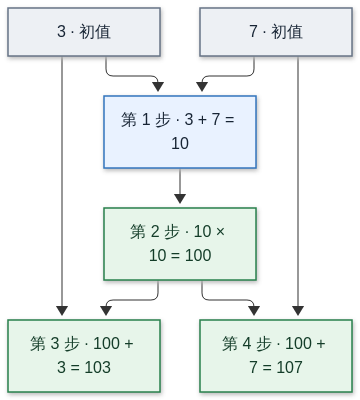
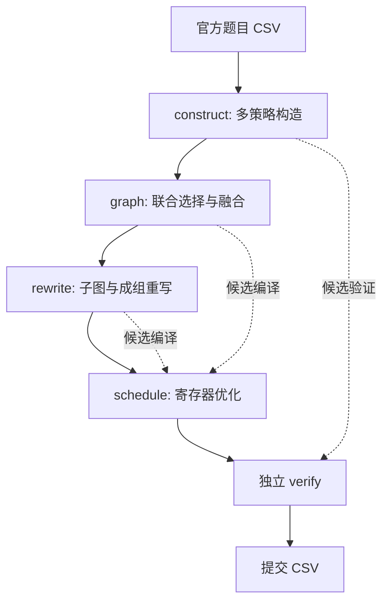

# Santa 2026 · 多目标算术程序：从构造到计算图优化

> 交互学习文档 · V8 Final / 功能化架构重构目标版
>
> **阅读状态说明：** V8 Final 的功能化等价重构已完成并通过 1,000 题全量验收；本文的源码布局、源码链接和命令对应重构后的 main。重构前的版本化基线为 [commit `9337a354`](https://github.com/Leonardo-F/kaggle-lab/tree/9337a3549bea09257cbf36ae1f8da2cbd452942b/competitions/santa-2026)；历史 V1–V8 实现与原始文档仍可从该提交和独立 worktree 复现。[重构复现报告](reports/v8-refactor.json)是可选记录：文件存在时互动报告会校验并展示其一致性结果，缺失时使用原始 V8 全量记录，不阻塞 Web 构建。

**核心问题：** 给定初值与目标集合，用有限寄存器和尽可能少的四则运算覆盖全部目标。我们的办法是先构造合法程序，再通过跨目标共享、全局路径选择、子图重写和寄存器调度压缩真实指令数。V1 到 V8 的本地全量成绩从 **250,642** 降至 **194,444**（减少 56,198 步，约 22.42%）。这不是 Kaggle 榜单成绩，也不是全局最优证明。

## 学习导航

| 想了解什么？ | 跳转 | 建议时间 |
|---|---|---:|
| 赛题怎么玩？亲手执行指令 | [01 赛题与手算](#01-赛题与手算) | 5 min |
| 为什么用计算图？ | [02 数学模型](#02-数学模型) | 8 min |
| 怎样生成候选表达式？ | [03 构造搜索](#03-构造搜索) | 10 min |
| 怎样让多个目标共享计算？ | [04 全局图优化](#04-全局图优化) | 10 min |
| V8 为什么更强？ | [05 子图重写](#05-子图重写) | 10 min |
| 48 个寄存器如何限制算法？ | [06 寄存器调度](#06-寄存器调度) | 8 min |
| 从 V1 到 V8 的变化 | [07 演进与实验](#07-演进与实验) | 5 min |
| 如何阅读新版源码？ | [08 当前与目标架构](#08-当前与目标架构) | 5 min |
| 怎样从零复现？ | [09 复现与交互回放](#09-复现与交互回放) | 按需 |
| V9 还能优化什么？ | [10 局限与研究方向](#10-局限与研究方向) | 8 min |

**动手入口：** [离线模拟器](../src/simulator.html) · [独立互动报告](../Santa-2026-Interactive-Report.html) · [成绩与提交](../submissions/README.md) · [实验进展](progress.md) · [公开方案对比](frontier-analysis.md)。

本文的折叠练习使用 Markdown 支持的 HTML `details`，图示复用原有 `diagrams/` 中的 PNG。请将文件放在原 `docs/` 中，以保留相对链接；也可在下文直接读图注及算式。Markdown 本身不运行 Python，不宣称可以直接求解新题；实际可执行的交互位于模拟器或 CLI。

---

## 01 赛题与手算

每题给定初始正整数列表 `starting_values`、目标列表 `targets`、数值上限 `value_limit`、寄存器数量 `registers`（正式题为 48）。程序每步读取两个已初始化寄存器，做加、减、乘或整除，将结果写到指定寄存器，允许覆盖操作数。结果必须为正整数且不超过上限；除法要求整除。目标只要曾经出现过即可，包括初值中的目标。单题最多 4,096 条指令，program 单元格最多 128 KiB。正式 1,000 题的指令数相加，越低越好。[Kaggle 题面](https://www.kaggle.com/competitions/santa-2026/overview) · [独立验证器](../src/verify.py)

指令 JSON 形式为 `[op, i, j, d]`，索引从 0 开始。先读 i、j 的旧值，后写 d。

### 练习 A：从 3 得到 9、27、81

初值 `R0=3`，上限 100。试着只用两个寄存器完成所有目标。

<details>
<summary>展开答案：3 步最优程序</summary>

| 步骤 | 指令 | R0 | R1 | 已完成目标 |
|---:|---|---:|---:|---|
| 0 | 初始 | 3 | 空 | 无 |
| 1 | `["*",0,0,1]` | 3 | 9 | 9 |
| 2 | `["*",1,0,0]` | 27 | 9 | 9, 27 |
| 3 | `["*",1,1,1]` | 27 | 81 | 9, 27, 81 |

```json
[["*",0,0,1],["*",1,0,0],["*",1,1,1]]
```

每条指令最多产生一个新目标；三个新目标至少三步，因此此程序达到下界。9 被覆盖仍算已命中。

</details>

### 练习 B：从 3、7 得到 100、103、107

初值 `R0=3, R1=7`，上限 120。分别计算三个目标，和共享同一个中间值，哪种更短？



<details>
<summary>展开答案：共享 10 与 100</summary>

| 步 | 算式 | 指令 |
|---:|---|---|
| 1 | 3+7=10 | `["+",0,1,2]` |
| 2 | 10×10=100 | `["*",2,2,2]` |
| 3 | 100+3=103 | `["+",2,0,0]` |
| 4 | 100+7=107 | `["+",2,1,1]` |

独立沿相同路线构造分别需 2、3、3 步，共 8 步；共享后只需 4 步。任何初值的一步运算均不能命中目标，故第一步至少需要准备一个中间值，再至少三步命中目标，四步最优。

</details>

[返回学习导航](#学习导航)

## 02 数学模型

### 2.1 真实目标：有限寄存器上的最短程序

记输入为 $\mathcal I=(\mathbf s,T,L,R)$，初值集合为 $S$，目标集合为 $T$。第 $k$ 条指令为 $p_k=(o,i,j,d)$。寄存器状态与已命中集合满足

```math
\begin{aligned}
z_k &= o(r_i^{(k-1)},r_j^{(k-1)}),\quad 1\le z_k\le L,\\
r_d^{(k)}&=z_k,\qquad r_h^{(k)}=r_h^{(k-1)}\quad(h\ne d),\\
H_0&=T\cap S,\qquad H_k=H_{k-1}\cup(T\cap\{z_k\}).
\end{aligned}
```

设 $\mathcal F(\mathcal I)$ 是符合全部规则并最终满足 $H_K=T$ 的程序集合，则

```math
K_R^\star(\mathcal I)=\min_{\pi\in\mathcal F(\mathcal I)}|\pi|,\qquad Q=\sum_{i=1}^{1000}|\pi_i|.
```

基本下界是 $K_R^\star\ge |T\setminus S|$；若新目标非空且没有任何初值的一阶合法运算能命中新目标，则还要至少多一步。

### 2.2 值依赖图：把程序压缩成共享结构

给每个非初值 $v$ 选择构造式 $v=o(a,b)$，得到有向无环图（DAG）。令依赖闭包 $D_G(v)$ 包含生成 $v$ 所必需的非初值节点及其自身：

```math
D_G(v)=\begin{cases}
\varnothing,&v\in S,\\
D_G(a)\cup D_G(b)\cup\{v\},&v\notin S,
\end{cases}
\qquad C(G)=\left|\bigcup_{t\in T}D_G(t)\right|.
```

若节点 $v$ 出现在 $m(v)$ 个目标闭包中，独立构造到共享构造的理想节省为

```math
\sum_{t\in T}|D_G(t)|-C(G)=\sum_{v:m(v)>0}(m(v)-1).
```

若已选择的依赖集合为 $U$，新目标 $t$ 的边际开销为 $|D_G(t)\setminus U|$。这比单看数值大小或表达式长度更贴近跨目标共享。

### 2.3 图更小，程序一定更短吗？

无限寄存器时，一个合法 DAG 可以按拓扑顺序每个有效节点计算一次。反过来，取任一合法程序中每个值首次出现时的构造式，即得到无环依赖图；去掉无用节点，其节点数不大于程序长度。故

```math
\min_{G\text{ 合法值图}} C(G)\le K_R^\star(\mathcal I).
```

有限寄存器中，同一图可能因活值过多而需要重算，甚至无法被当前编译器成功编译。因此 $C(G)$ 是搜索代理，不是正式分数，必须完整回放后比较 $|\pi|$。

<details>
<summary>思考题：目标 100 完成后是否可以立刻释放其寄存器？</summary>

从赛题规则看可以覆盖；但从后续依赖看，103 和 107 还要用到 100，提前释放可能迫使重算。必须区分“目标已达成”和“值已无未来用途”。

</details>

[返回学习导航](#学习导航)

## 03 构造搜索

目标是从题目本身生成多个可执行候选，而不是从已有答案出发。以下技术对应历史 V1–V5，在 V8 中仍是有效构造基础。

### 3.1 多进制分解（V1）

对基数 $b>1$，欧几里得除法给出

```math
q=\lfloor t/b\rfloor,\quad r=t-bq,\qquad t=bq+r=b(q+1)-(b-r).
```

两种表达式分别从目标下方和上方逼近；若上方乘积超过 $L$ 则排除。对尚未构造的商继续递归分解。实现尝试多个固定基数、目标顺序与自适应候选池。

<details>
<summary>练习：已有 3、4、7、9、10，生成 347 和 349</summary>

先构造 30=3×10、34=30+4、340=34×10，再加 7 和 9，总共 5 步。共享 340 可避免重复三步；并不声称这是任意候选下的最优值。

</details>

### 3.2 反推操作数（V3）

枚举已知或已有构造方式的 $a$，反推出 $b$，用哈希表查询，而不必遍历全部 $(a,b)$ 对。

| 表达式 | b | 必要条件 |
|---|---|---|
| $t=a+b$ | $t-a$ | $t>a$ |
| $t=a-b$ | $a-t$ | $a>t$ |
| $t=b-a$ | $t+a$ | $b\le L$ |
| $t=ab$ | $t/a$ | $a\mid t$ |
| $t=a/b$ | $a/t$ | $t\mid a$ |
| $t=b/a$ | $ta$ | $b\le L$ |

每条还要验证 $1\le b\le L$ 和表达式合法性。固定目标、$M$ 个 a 时最多提出 $6M$ 个查询（不是整题算法的复杂度）。例如已知 13、欲得 91，可直接查询 7。

### 3.3 不局限于最近的商（V4）

固定基数 $b$，在已有值中查找标准商附近的廉价商 $\tilde q$：

```math
p=b\tilde q,\qquad \tilde r=|t-p|,\qquad t=p+\operatorname{sgn}(t-p)\tilde r.
```

当乘积尚未构造且余数非零时，边际成本为

```math
\left|\left(D_G(b)\cup D_G(\tilde q)\cup D_G(\tilde r)\cup\{p,t\}\right)\setminus U\right|.
```

已有乘积则复用；余数为零时无需额外加减。若 9、13 已可用，103=10×9+13 可能比标准商路线更便宜。核心是构造成本而非数值距离。

### 3.4 乘积池与模余数索引（V5）

从便宜因子生成乘积池，并查找 $t-p,p-t,p+t$ 等可组合的值。对选定基数 $b$，使用

```math
t=bq+\sigma r,\quad \sigma\in\{-1,+1\}\quad\Longrightarrow\quad r\equiv\sigma t\pmod b,\quad q=(t-\sigma r)/b.
```

每个选中基数的余数桶最多保留两个廉价乘积。只要商、乘积及运算合法，可以选择大于基数的余数。

| 目标 1003，基数 64 | 商 | 偏移 | 表达式 |
|---|---:|---:|---|
| 向下 | 15 | 43 | 64×15+43 |
| 向上 | 16 | 21 | 64×16−21 |
| 模桶 | 13 | 171 | 64×13+171 |

<details>
<summary>为什么第三条路线可能更好？</summary>

171 与 43 模 64 同余，若 171 已由 9×19 廉价得到且 13 已可用，就可能避免生成 43。扩大候选池并不保证更好：有限预算下排序会改变，历史 8 题消融也出现过退化。

</details>

### 3.5 自适应构造器组合（V7）

V8 的内部基线仍使用 V7 特征规则及 V5 构造器。令 $n=|T|$、$w_{\max}$ 和 $w_{\min}$ 为目标位宽最大/最小值。

| 条件 | 目标排序 | seed | width |
|---|---|---:|---:|
| 始终 | 数值升序 | 5 | 3 |
| n≥20，位宽跨度≥6 | 位宽降序，同宽数值升序 | 6 | 3 |
| n≥20，位宽跨度小于6 | 低字节 t mod 256 | 6 | 3 |
| n≥20，最大位宽≥40 | 数值升序 | 7 | 4 |
| n小于20，初值数≤2，最大位宽≥25 | 数值升序 | 7 | 4 |

默认至多取 3 个计划；候选均从本轮题目重新生成，回放验证后再加入当前候选集合。选择规则是启发式，未训练选择器。注意这里的 width 是构造器的搜索宽度参数，不是硬件寄存器位宽。

[返回学习导航](#学习导航)

## 04 全局图优化

### 4.1 依赖替换与引用计数（V2–V3）

同一数值可能有多个等价表达式。改写某个节点，只有旧依赖的最后一个引用消失时才能节省一个有效节点。令 $\rho_G(v)>0$ 表示节点仍被目标闭包使用，则

```math
\Delta C=\sum_{v\notin S}(\mathbf 1[\rho_{G'}(v)>0]-\mathbf 1[\rho_G(v)>0]).
```


例如原图用 110 产生 103 和 107，只改写一个目标并不能删除 110；两个目标都改为复用 100，110 才能剪枝。V2 六轮局部扫描并尝试多种求值顺序；V3 增加反查候选及最多 100 轮大邻域融合。各代方法在当前运行中产生候选，而非读取前次提交。

### 4.2 动态无环替换（V6）

早期替换受值的发现顺序限制。V6 为已发现数值提出更多表达式，每次替换前沿当前依赖图判断环路，用引用计数维护活跃节点。节点搜索默认 180 轮；额外加入 seed=4 升序构造候选。本轮生成的程序是融合素材，不能替换为历史答案。

### 4.3 多图完整路径联合选择（V6–V7）

对每个目标 $t$，从各候选图提取完整见证路径 $p_t\in\mathcal P_t$，联合代理目标为

```math
\min_{p_t\in\mathcal P_t}\left|\bigcup_{t\in T}D_{t,p_t}\right|.
```

实现用 Python 整数 bitset 表示依赖集合，并集用按位或，成本用 `bit_count()`。先初始化及坐标搜索，再模拟退火选择路径。V6 默认路径选择 300 轮；V7 的多图路径选择 400 轮，扰动 1–8 个目标路径，温度由 3 降至 0.15，按 Metropolis 准则接受部分劣解。V7 还对最多两条最短候选执行额外动态融合（每次 120 轮）。最终编译、回放，按真实指令数保留最好合法程序。


<details>
<summary>练习：为什么每个目标分别选最短路径不一定最优？</summary>

设 A、B 的各自最短闭包大小均为 3，且彼此不交；另有各大小为 4 的路线，二者共享三个中间值。分别最短的并集成本为 6，第二组并集成本为 5，因此联合选择可能更优。这个例子只说明集合代理成本，不代表有限寄存器程序一定节省一步。

</details>

[返回学习导航](#学习导航)

## 05 子图重写

V8 Final 从本轮 V7 基线出发，先列表调度，再双运算重写、三运算重写、等成本探索、严格成组修复、等成本成组修复，最后做寄存器优化。冻结版本不包含开发期未进入最终管线的退火与其他额外构造实验。


### 5.1 双运算子图重写

删除只服务于节点 $v$ 的旧依赖（令 $R$ 为可移除节点集，$K$ 为保留节点集），枚举第 3.2 节的反推关系。如果另一操作数 b 已在保留图中，比较新增依赖与移除依赖；若 b 尚无构造，则可从两两运算池寻找 $b=o_2(c,d)$。示意增量（在新旧替换根节点成本相互抵消的计数约定下）为

```math
\Delta C=|(D(a)\cup D(b))\setminus K|-|R|.
```

若新增 b，则示意增量为 $1+|(D(a)\cup D(c)\cup D(d))\setminus K|-|R|$。实际代码依据完整闭包及环检测确认变化，不能用近似公式替代验证。两轮扫描后指令数从 198,374 降至 195,705，是 V8 最大阶段贡献。

### 5.2 三运算重写与等成本探索

进一步对可移除专属依赖至少为 3 的节点寻找组合构造：

```math
v=o_1(a,b),\qquad b=o_2(c,d).
```

输入候选来自保留图或两两运算池。每轮只重点处理删除收益最大的 10 个节点，按位宽桶取样，最多保留 8 个提案。严格阶段两轮将 195,705 降为 195,090；随后额外一轮等成本探索允许改变图结构，即使 $\Delta C=0$，并始终保留已经验证的最短程序，得到 194,881。

### 5.3 成组切断与修复（group repair）

一次选择 2–4 个互不依赖的节点作为切断集 $C$，冻结其余依赖 $F$，为每个 $v\in C$ 找新表达式候选 $A_v$。联合束搜索最小化

```math
\min_{e_v\in A_v}\left|F\cup C\cup\bigcup_{v\in C}D(e_v)\right|.
```


束宽 10；候选按依赖并集、补丁大小与确定性字典序排序去重，鼓励多个候选共享新中间值（排序折扣 0.8）。每轮尝试编译最好的三个补丁。严格阶段 6 轮，只接受活跃节点数下降的图更新；等成本阶段 8 轮，每三轮之一允许中间图增加 1 个活跃节点，并有相对初始图的增长上限。最终保留的仍是更短合法程序。两个阶段分别省 62 与 22 步。

<details>
<summary>等成本甚至暂时更大的图，为什么值得探索？</summary>

图结构变动可能创造新的共享中间值或降低寄存器压力。搜索中的探索状态和最终提交的 incumbent 是两个对象：前者可暂时不改善，后者始终保留已验证的最短程序。V9 的算法创新可单独研究更开放的探索策略；V8 等价重构不能改变现有接受规则。

</details>

### 5.4 搜索预算与复杂度

设当前有效节点数为 n，值池大小为 m。两两运算池的枚举规模至多 O(m²)，单轮双运算候选扫描约 O(nm+m²)（不包含所有闭包集合运算、编译及回放成本）。图闭包、编译和多轮搜索会带来额外开销，不能把候选数上界当作整题运行时间上界。

| 阶段 | 冻结预算 |
|---|---|
| 双运算 | 2 轮，候选 b 构造数量受限 |
| 三运算 | 2 轮，每轮预算 10 个节点，每节点至多 8 个提案 |
| 等成本探索 | 额外 1 轮 |
| 严格成组 | 6 轮，束宽 10，最多编译 3 个补丁/轮 |
| 等成本成组 | 8 轮，束宽 10，同上 |
| 最终调度 | 32 个候选顺序，优先完整编译压力较低的 8 个 |

[返回学习导航](#学习导航)

## 06 寄存器调度

固定图仍须决定拓扑顺序、寄存器分配及被覆盖值的重算。令 next(v) 表示下一次使用位置，已发射且仍有后续用途的活值集合为

```math
L_k=\{v:\ v\text{ 已发射且 }\operatorname{next}(v)>k\}.
```

### 6.1 V7：共享闭包聚类与 last-use overwrite

V7 枚举六种目标根顺序（原序、逆序、升序、降序、两种共享闭包聚类）、两种 DFS 子树次序、两种淘汰策略：distance 优先淘汰下一次使用最远的值；cost 比较 $(\operatorname{next}(v)-k)/(1+|D(v)|)$，并按下一次使用与数值打破平局。允许操作数在最后一次使用时原地覆盖。初值保护与失败回退按代码规则执行。

### 6.2 V8：列表调度重编译

V8 的首个额外阶段不改表达式，而尝试八种拓扑顺序：四种列表调度（释放寄存器优先、产生新值优先、闭包大小、随机优先级），以及四种目标顺序 DFS（原序、逆序、闭包小到大、闭包大到小）。每种顺序尝试分配寄存器，最后使用时覆盖，完整回放后只接受更短合法程序。全量仅省 14 步。

### 6.3 V8 Final：压力模型与重计算

最后生成 32 个候选根顺序，使用随机打乱、闭包大小排序、共享闭包聚类、随机交换等策略。轻量模型按以下三元组排序：

```math
\operatorname{pressure}(\pi)=(\text{溢出步数},\text{峰值活值数},\text{活值面积}).
```

优先完整分配压力最小的 8 个；淘汰考虑下一次使用距离、剩余闭包成本，支持最后使用覆盖。实际回放选择最短合法程序，节省 353 步。这些启发式不是寄存器调度的全局最优证明。

<details>
<summary>练习：如果只允许两个寄存器，会发生什么？</summary>

重新查看练习 A，两个寄存器已足够，因为 3 在第 2 步最后使用，9 在第 3 步最后使用。练习 B 的四步方案用了第三个寄存器保存 10/100；当只剩两个寄存器时，需要重新寻找可行程序，而不是直接把寄存器编号 2 改为 0 或 1。真实程序取决于可重建值与活值生命周期。

</details>

[返回学习导航](#学习导航)

## 07 演进与实验

### 7.1 同一批 1,000 题的本地成绩


| 版本 | 核心贡献 | 指令数 | 较前代少 | 改善 / 持平 / 退化 | 独立验证记录 |
|---|---|---:|---:|---|---|
| V1 | 多进制、自适应构造 | 250,642 | — | — | [1,000/1,000](reports/v1.json) |
| V2 | 宽搜索与依赖压缩 | 236,449 | 14,193 | 829/171/0 | [1,000/1,000](reports/v2.json) |
| V3 | 反推查找、联合融合 | 227,799 | 8,650 | 734/266/0 | [1,000/1,000](reports/v3.json) |
| V4 | 廉价邻近商 | 219,462 | 8,337 | 723/277/0 | [1,000/1,000](reports/v4.json) |
| V5 | 乘积池与模余数 | 216,404 | 3,058 | 416/584/0 | [1,000/1,000](reports/v5.json) |
| V6 | 动态无环、路径联合 | 204,255 | 12,149 | 799/201/0 | [V6 报告](reports/v6.json) |
| V7 | 多构造器、调度 | 198,388 | 5,867 | 717/283/0 | [1,000/1,000](reports/v7.json) |
| V8 Final | 子图重写、组修复、寄存器 | **194,444** | 3,944 | 775/225/0 | [1,000/1,000](reports/v8.json) |

V1–V5 原复跑耗时分别为 156.5、285.5、424.8、624.2、640.6 秒（多版本并行，V5 6 个工作进程，其余 4 个，不是严格等资源 benchmark）。V7 与 V8 的 9 进程复跑分别为 878.73 与 1,174.13 秒。V7 最长 564 步；V8 最长 535 步。历史记录中 V6 以及各代复跑的配置以原报告为准；所有表格均为既有历史证据，不是本次重构后的测量。

例题 `scored_0626` 在 V1–V5 为 275→273→258→256→249；`scored_0289` 为 28→28→27→27→27。历史早期 285,288→272,748、269,369→263,575 属不同实验，不能并入同一独立版本曲线。[历史进展](progress.md)

### 7.2 各代全量阶段贡献

| 版本 | 过程与全量指令数 |
|---|---|
| V2 | 250,642 → 宽搜索239,693 → 图压缩236,449 |
| V3 | 236,449 → 反查228,527 → 融合227,799 |
| V5 | 219,462 → 构造217,279 → 融合216,404 |
| V6 | 216,404 → 无环搜索215,938 → 额外候选/融合205,959 → 路径联合204,255 |
| V7 | 204,255 → 自适应构造200,987 → 路径并集200,034 → 动态融合199,675 → 调度198,388 |

V6 路径联合额外改善 125 题。V7 的阶段合计改善 5,867 步，约 2.8724%。这些阶段属于各自实验报告，不等于所有模块在相同计算预算下的独立因果贡献。

### 7.3 V8 八阶段完整消融记录

| 阶段指标键 | 阶段 | 总指令数 | 增量减少 |
|---|---|---:|---:|
| `v7` | 同轮基线 | 198,388 | — |
| `list_schedule` | 列表调度 | 198,374 | 14 |
| `v8` | 双运算子图重写 | 195,705 | 2,669 |
| `v81` | 三运算子图重写 | 195,090 | 615 |
| `v82` | 等成本探索 | 194,881 | 209 |
| `v8group_strict` | 严格成组重构 | 194,819 | 62 |
| `v8group_neutral` | 等成本成组重构 | 194,797 | 22 |
| `v8final` | 最终寄存器优化 | **194,444** | 353 |

双运算重写贡献约 67.7% 的 V8 增量节省（2669/3944）。全量减少 1.988%（相对 V7）。这些是同一轮运行的逐题阶段指标累加；不能拼接不同配置的最优子成绩。

### 7.4 历史样本消融（折叠阅读）

<details>
<summary>展开 V3–V8 样本实验及限制</summary>

| 研究样本 | 记录 | 说明 |
|---|---|---|
| V3，24 题 | 6,941→6,537 | 22 改善、2 变长；[报告](reports/v3-handoff-ablation.json) |
| V4，24 题 | 6,473→6,310→6,290 | 基线→新增候选→融合；[历史版本](https://github.com/Leonardo-F/kaggle-lab/blob/35a688db3a01182d07d1ae2000a75f3191e1b57e/competitions/santa-2026/docs/algorithm-evolution.md) |
| V5，8 题 | 1,855→1,863→1,863→1,850 | 扩池、双乘积、模余数；[报告](reports/v5-handoff-ablation.json) |
| V6，100 题 | 22,653→22,602→21,492→21,476→21,298 | 非均匀随机开发样本 |
| V7，60 题 | 11,460→11,249→11,231→11,192→11,150 | 从排除开发样本的900题抽取，Random(707)，45改善15持平，155额外候选合法，126.47秒（4进程） |
| V7，12 题 | 2,306→2,305 | retain-v6-graphs 增益很小，默认关闭 |
| V8，100 题 | 20,862→20,570 | V8.0可比样本 |
| V8，60 题 | 13,142→12,914 | V8.2可比样本 |
| V8，28 题 | 6,089→5,977 | 冻结管线，23改善5持平，123.81秒 |

样本来自不同实验或分层采样，不能相互直接比较，也不能当作全量分数。原始证据、参数与耗时详情以[原文固定版本](https://github.com/Leonardo-F/kaggle-lab/blob/9337a3549bea09257cbf36ae1f8da2cbd452942b/competitions/santa-2026/docs/algorithm-evolution.md)及 reports 为准。

</details>

### 7.5 复跑证据

V7 的归档 CSV SHA-256：`0bd4c26ac3ba32c5fb6aced54e14e6269fde836dbfe671f51cbdb116eb7dacef`。

V8 的归档 CSV SHA-256：`6f15091bcfddf4335f69126c2088696dfa7a9a3fcb9c4de6dbaa448aca1279fd`。

既有复跑记录中，两版各自与交接 CSV 逐字节一致，SQLite `PRAGMA integrity_check` 为 `ok`，1,000 记录全部重放通过。来源：[V7 报告](reports/v7.json)、[V8 报告](reports/v8.json)。

2026-11-25 的功能化等价重构再次从官方题目独立求解正式 1,000 题：**194,444 步**、1,000/1,000 合法、最长 535 步，八阶段总分为 **198,388 → 198,374 → 195,705 → 195,090 → 194,881 → 194,819 → 194,797 → 194,444**。生成的 CSV 与归档 V8 **逐字节一致**（SHA-256 `6f15091bcfddf4335f69126c2088696dfa7a9a3fcb9c4de6dbaa448aca1279fd`），775 题改善、225 题持平、0 题退化。冻结基线另一次全量复跑用于逐题八阶段指标对照。命令、输入哈希、逐题比较、测试和耗时的完整记录见[重构报告](reports/v8-refactor.json)。

[返回学习导航](#学习导航)

## 08 当前与目标架构

### 8.1 为什么历史上需要多个版本？

在基线提交 `9337a354` 中，`v8.py` 仅转发 `v8_group.optimize`；group 调用 three、rewrite、register，rewrite 从 V7 重新生成候选，V7 依赖 V5/V6，V6 依赖 V5，V5 依赖 V3/V4。V1/V2 文件独立于 V8 调用链，但 V3 内部的早期构造策略仍参与当前运行。等价重构先迁移实际调用的每个阶段，再用同一批题目逐题确认程序与阶段指标不变，最后才删除版本文件。旧实现保存在 Git 历史中，不再作为 main 的运行依赖。

### 8.2 现状：按功能而不是版本管理



**不支持 Mermaid 的阅读器：** 官方输入 → 构造 → 图优化 → 重写 → 调度 → 验证 → 提交。真实 V8 中多阶段都存在回放和调度，图仅展示职责，不表示把原有顺序简化为一次直线执行。

| 当前文件 | 功能 | 历史来源（固定提交） |
|---|---|---|
| [common.py](../src/algorithms/common.py) | 基础算术、回放、固定进制、共享 DAG 编译 | [common](https://github.com/Leonardo-F/kaggle-lab/blob/9337a3549bea09257cbf36ae1f8da2cbd452942b/competitions/santa-2026/src/algorithms/common.py) |
| [construct.py](../src/algorithms/construct.py) | 构造、反查、邻近商、模余数 | [V3](https://github.com/Leonardo-F/kaggle-lab/blob/9337a3549bea09257cbf36ae1f8da2cbd452942b/competitions/santa-2026/src/algorithms/v3.py)、[V4](https://github.com/Leonardo-F/kaggle-lab/blob/9337a3549bea09257cbf36ae1f8da2cbd452942b/competitions/santa-2026/src/algorithms/v4.py)、[V5](https://github.com/Leonardo-F/kaggle-lab/blob/9337a3549bea09257cbf36ae1f8da2cbd452942b/competitions/santa-2026/src/algorithms/v5.py) |
| [graph.py](../src/algorithms/graph.py) | 图提取、闭包、融合与路径选择 | [V6](https://github.com/Leonardo-F/kaggle-lab/blob/9337a3549bea09257cbf36ae1f8da2cbd452942b/competitions/santa-2026/src/algorithms/v6.py)、[V7](https://github.com/Leonardo-F/kaggle-lab/blob/9337a3549bea09257cbf36ae1f8da2cbd452942b/competitions/santa-2026/src/algorithms/v7.py) |
| [rewrite.py](../src/algorithms/rewrite.py) | 双/三运算、等成本、组修复 | [rewrite](https://github.com/Leonardo-F/kaggle-lab/blob/9337a3549bea09257cbf36ae1f8da2cbd452942b/competitions/santa-2026/src/algorithms/v8_rewrite.py)、[three](https://github.com/Leonardo-F/kaggle-lab/blob/9337a3549bea09257cbf36ae1f8da2cbd452942b/competitions/santa-2026/src/algorithms/v8_three.py)、[group](https://github.com/Leonardo-F/kaggle-lab/blob/9337a3549bea09257cbf36ae1f8da2cbd452942b/competitions/santa-2026/src/algorithms/v8_group.py) |
| [schedule.py](../src/algorithms/schedule.py) | 三种合法编译与寄存器调度 | [register](https://github.com/Leonardo-F/kaggle-lab/blob/9337a3549bea09257cbf36ae1f8da2cbd452942b/competitions/santa-2026/src/algorithms/v8_register.py)、V7、rewrite |
| [solver.py](../src/algorithms/solver.py) | 唯一公开管线、`SOLVER_VERSION`、配置和阶段指标 | [V8 入口](https://github.com/Leonardo-F/kaggle-lab/blob/9337a3549bea09257cbf36ae1f8da2cbd452942b/competitions/santa-2026/src/algorithms/v8.py) |

另保留 `__init__.py`、`graph_solver.py`、`checkpoint.py`、`verify.py` 及模拟器。`construct.py` 中 V4/V5 两个构造策略合并为同一参数化实现：关闭乘积池和模余数开关时与 V4 完全一致，打开时与 V5 完全一致；V3 的早期 beam 因候选空间不同而保留为独立函数。历史 V1–V8 源码完整目录见[固定 Git 提交](https://github.com/Leonardo-F/kaggle-lab/tree/9337a3549bea09257cbf36ae1f8da2cbd452942b/competitions/santa-2026/src/algorithms)。

算法版本是一次研究发布，不等于一套永久 Python 模块。V9 研究将修改相关功能，而历史实现在 Git 恢复。历史阶段指标仍可保留用于实验比较。

[返回学习导航](#学习导航)

## 09 复现与交互回放

### 9.1 最新求解：默认入口

从 Kaggle 接受规则并下载数据，放入赛题目录 `data/`。使用 Python 3.11+（检查点的文件锁依赖 POSIX）。以下命令对应重构后的 main；默认入口只运行当前 V8 等价求解器，`--version v8` 是兼容别名，旧版本 v1–v7 会提示改用固定提交的 worktree。

```bash
python src/graph_solver.py data/puzzles.csv --output experiments/v8-rerun.csv --jobs 8
python src/verify.py data/puzzles.csv experiments/v8-rerun.csv
```

输出路径应不存在，不覆盖已有文件。需要中断恢复时：

```bash
python src/graph_solver.py data/puzzles.csv --output experiments/v8.csv \
  --checkpoint experiments/v8.sqlite --jobs 8
# 中断后使用同一输入、代码、参数、检查点及输出路径
python src/graph_solver.py data/puzzles.csv --output experiments/v8.csv \
  --checkpoint experiments/v8.sqlite --resume --jobs 8
```

检查点绑定输入哈希、Python 版本、CLI/验证器/`algorithms/` 全部源码指纹与搜索参数；恢复时重放已保存记录并校验摘要。`--stop-after N` 限制本次调度的未完成题目数量；只有完成全部输入才导出 CSV（正式数据为 1,000 题）。同一指纹下可调整 jobs。旧布局的 SQLite 会被明确拒绝，应使用原 SHA 继续或新建检查点。

仅验证历史结果（不运行求解器）：

```bash
python src/verify.py data/puzzles.csv submissions/elf-calculator-independent-v8-score-194444.csv
```

### 9.2 历史版本独立复现

重构后不要求 main 同时维护旧版模块。使用包含所有 V1–V8 的固定提交，在另一 worktree 执行旧入口（从仓库根目录）：

```bash
git worktree add --detach ../kaggle-lab-santa-history 9337a3549bea09257cbf36ae1f8da2cbd452942b
cd ../kaggle-lab-santa-history/competitions/santa-2026
# 把 /absolute/path/puzzles.csv 替换为本地实际数据路径
version=v7
python src/graph_solver.py /absolute/path/puzzles.csv --version "$version" \
  --output "experiments/${version}-rerun.csv" --jobs 8
python src/verify.py /absolute/path/puzzles.csv "experiments/${version}-rerun.csv"
```

`version` 可设为 v1 至 v8。这里使用已知提交，不假设 Tag 已经创建。官方数据不得提交到 Git，所有算法从原始题目重新求解。历史答案仅用于回放和结束后的回归检查。

### 9.3 动手用模拟器

1. 在浏览器离线打开 [simulator.html](../src/simulator.html)。
2. 在自定义题区域输入练习 A 或 B，查看 JS 求解与寄存器变化；它并非完整 Python V8。
3. 在 Python 版本回放区域导入题目 CSV、各版本真实输出 CSV，选择相同题号并比较。
4. 观察目标命中、寄存器覆盖、指令数及共享节点/重算；切换版本，比较同一题的不同程序。可以使用已有 [V7 CSV](../submissions/elf-calculator-independent-v7-score-198388.csv) 和 [V8 CSV](../submissions/elf-calculator-independent-v8-score-194444.csv)。

[互动算法报告](../Santa-2026-Interactive-Report.html) 仍保留历史学习视图。重构只改变 Python 源码组织，不能以此为由删掉历史比较。

### 9.4 重构验收状态

- [x] 已有 V8 基线历史记录：194,444 步，1,000/1,000 合法。
- [x] 功能化迁移及去重完成；V4/V5 构造器合并为同一参数化实现，共享 DAG 编译器已抽到 `common.py`。
- [x] 新入口、检查点、Python/Node/Web 测试及报告/构建 `--check` 通过。
- [x] 新布局从官方题目独立生成 1,000 道结果，八阶段总分及逐题程序与冻结 V8 一致。
- [x] 重构报告 [v8-refactor.json](reports/v8-refactor.json) 已写入；代码重构提交为 `0ec0ec0`。

本次全量复跑使用 6 个进程、独立 SQLite 检查点，`PRAGMA integrity_check` 为 `ok`，1,000 条记录全部重放通过；输出与归档 V8 逐字节一致。practice 数据另以 8 进程独立核验 200/200 题合法（40,207 步，最长 557 步，373.0 秒）。逐题程序、八阶段指标、测试命令和耗时见重构报告。

[返回学习导航](#学习导航)

## 10 局限与研究方向

### 10.1 候选池中的精确图选择模型


给定有限候选值集合 $V$，每个非初值 v 对应合法表达式集合 $E_v$；$x_v$ 表示保留值，$y_e$ 表示选择表达式，$h_v\in\{0,\ldots,|V|-1\}$ 表示拓扑层次。$M=|V|$。可建模为

```math
\begin{aligned}
\min\quad &\sum_{v\in V\setminus S}x_v\\
\text{s.t.}\quad &x_v=1 &&(v\in S\cup T),\\
&\sum_{e\in E_v}y_e=x_v &&(v\in V\setminus S),\\
&x_{a_e}\ge y_e,\quad x_{b_e}\ge y_e &&(e\in E_v),\\
&h_v\ge h_{a_e}+1-M(1-y_e) &&(e\in E_v),\\
&h_v\ge h_{b_e}+1-M(1-y_e) &&(e\in E_v),\\
&h_s=0 &&(s\in S).
\end{aligned}
```

选中表达式强制两个操作数同时被选中且拓扑层更早，从而避免环；反之任何候选池内的合法 DAG 均可赋予拓扑层次。该模型优化的是有限候选池、无限寄存器松弛下的图成本，不是完整赛题最优性；也未用于表中 V8 正式成绩。

### 10.2 V9 研究建议（尚未验证）

| 优先方向 | 问题 | 如何验证 |
|---|---|---|
| 扩展构造表达式空间 | 当前图的局部重写受限于已有值 | 同预算比较新候选覆盖与真实步数 |
| 多图联合搜索 | 单个候选未必有最佳共享表达式 | 路径池多样性、选中表达式及边际收益 |
| 寄存器感知的图优化 | 图节点代理忽略重算 | 记录 C(G)、实际指令、重算、峰值活值 |
| 可跨平台的确定性 | 随机数、枚举顺序及并行差异 | 固定输入与环境对照、逐题回归 |
| 小题精确下界 | 启发式离最优多远？ | 小上限时 BFS 状态 (r,H)，单位指令代价；首次覆盖全部目标即最优 |

V8 使用有限候选池、有限邻域与启发式调度，不能证明 194,444 是下界。未来消融应固定题集、硬件、进程数、随机种子和预算，报告分数、耗时分布、改善/持平/退化题数及失败原因。V9 研究允许探索阶段退化，与本次 V8 等价重构的逐题一致性验收不是一回事。V9 应直接修改相关的功能模块，而不是长期新增 `v9.py`。

### 10.3 相关研究

- Bos 与 Coster，[Addition Chain Heuristics](https://link.springer.com/chapter/10.1007/0-387-34805-0_37), CRYPTO ’89：加法链和多目标共享。Santa 还允许其他运算、有限数值与有限寄存器。
- Sethi 与 Ullman，[The Generation of Optimal Code for Arithmetic Expressions](https://doi.org/10.1145/321607.321620), JACM 1970：有限寄存器上的表达式求值。Santa 还要选择跨目标共享的表达式图。
- [公开方案对比与前沿探索](frontier-analysis.md)；[历史实验进展](progress.md)。公开结果用于参考与比较，不作为当前独立求解输入。

---

**学习总结：** Santa 的难点不是单独计算一个数，而是同时选择多个目标的构造路径，复用有价值的中间结果，并在有限寄存器内将图编译为最短合法程序。最新算法只有一套，构造、图优化、重写、调度是可演进的组成模块；V1–V8 的历史是它的研究证据，而不是必须永久留在 main 中的八套实现。

[返回学习导航](#学习导航)
